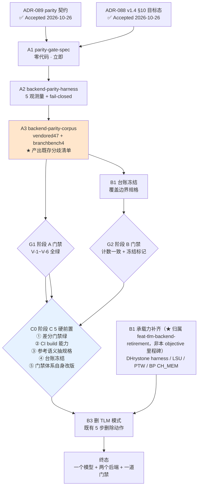

# Objective: objective-backend-parity-and-single-model

> **架构授权**：ADR-089（双后端差分 parity 门禁，✅ Accepted 2026-10-26）+ ADR-088 v1.4 §10（目标态与三段迁移路径，✅ Accepted 2026-10-26）
> **用户诉求（2026-10-26）**：「项目只需要提供 CppHDL 默认的仿真模式和有 Verilator 后端的仿真，完全移除 TLM 的建模，只依赖 CH_MEM 模式建模；CH_MEM 默认仿真保证功能正确，Verilator 后端证明可转 Verilog；只要这两种仿真运行的结果一致就算建模成功。」
> **★ planner 对该诉求的拆分裁决**（见 §1.2）：诉求包含**两个独立决定**，价值差一个量级 ⇒ **P1（parity 机制换成差分执行）立即做**；**P2（删 TLM 模式）绑 B3，不提前**。

---

## 1. 驱动诊断（Why now）

### 1.1 现状（实测，非推断）

| # | 事实 | 取证 |
|---|---|---|
| 1 | ★ **两个仿真后端从不互比** | vendored ELF 47 = **仅 Simulator**（`tests/cpu/test_cpu_chmem_vendored_elf.cpp`：`create_simulator()`）；Verilator 48 ELF = **仅 Verilator**（`tools/verilator_runner/cpu_verilator_sim.cpp`）；两侧**不同 corpus、不同 oracle**（都只判 `tohost==1`）⇒ **跨后端断言仅 1 条**（`[mem-drift]` 锚，只钉 `ch_mem::aread` 的 0-cycle 对齐） |
| 2 | ★ **「一致性证据」是人工计数代理，且已在漂** | 覆盖平价台账 463 条：头部声明 partial **292** vs 条目级实测 **282**；`per_thread_ghr_isolation` 简报 `not-covered` / 台账 `partial` ⇒ 代理指标开始骗自己；且它对「两后端是否一致」**完全无感** |
| 3 | ★ **双后端 = 两条 ISA 语义**（不是「一份代码两个后端」） | M 扩展：TLM radix-2（MUL=455c/DIV=380c）vs CH_MEM 组合式（mul=472c/div=94c）· CSR：TLM **纯 stub** vs CH_MEM 566 行 · MMU PTW：TLM 完整 walk vs CH_MEM 回退 vaddr · BP：TLM 319 行 vs CH_MEM 当时为 0（`feat-tlm-backend-retirement` 实测表）⇒ ★ 用「一致性」卡它 = **错误的度量** |
| 4 | ★ **后端分歧类是有界的** | 2026-10-21 上游 `c27543d` 修的 `ch_mem::aread` 1 拍滞后 ⇒ 10 个 rv32ui ELF 失败 ⇒ ★ 那**不是建模错误**，是**后端时序不一致**（Simulator 1 拍 vs 生成 Verilog 0 拍）⇒ 差分执行会**第一优先**抓到这一类 |
| 5 | ★ **回归速度落差巨大** | TLM binary **432 case ≈ 0.6s** · CH_MEM Simulator vendored 47 ≈ **1594s（~34s/ELF）** · Verilator（dhrystone 端到端，含 Verilog 生成 + Verilator 编译）**18.85s**（★ **实测出处**：2026-10-26 本机 4 核，HEAD `2703ca8` + 增量 3 未验证代码；CH_MEM 侧 = `chipforge_tests_chmem` 的 `chmem_vendored_elf_tohost1` 单 case 26m34s；Verilator 侧 = `verilator_perf_baseline` ctest entry 18.85s） ⇒ ★ 删 TLM 模式 = **删掉唯一的亚秒级回归环** |
| 6 | ★ **CI 零保护** | `architecture-gates.yml` 只跑 8 个架构门禁脚本，**不构建项目** ⇒ 门禁 step 恒 SKIP（ADR-088 §5.2 判据 4）⇒ 删掉 463 个 TLM-only case 后**没有任何自动机制能发现语义退化** |
| 7 | ★ **B3 已在 phase-5 排期** | `feat-tlm-backend-retirement` 的 B3 段 + ADR-088 §5.2 删除判据 ⇒ ★ 本 objective **不重开 B3**，只**加前置 + 改一致性证据的度量方式** |

### 1.2 ★ 用户诉求的拆分裁决

| | 诉求 | 裁决 | 理由 |
|---|---|---|---|
| **P1** | parity = **同一模型两后端差分执行** | ✅ **立即做**（阶段 A） | ★ 它补上的是**今天真实存在的空洞**（事实 1）⇒ 且**独立于** TLM 退役 ⇒ 立刻见效 |
| **P2** | 移除 TLM 模式，只留 CH_MEM | ⚠️ **绑 B3**（阶段 C） | ★ 方向与既有 roadmap（`feat-tlm-backend-retirement` 目标「CH_MEM 单后端收敛」）**同向** ⇒ 但**时点**受 5 条硬前置约束（事实 5/6 + 参考语义抽规格 + 台账冻结 + 门禁体系自身改版）⇒ ★ 提前删 = 在最大改动点上同时拆掉安全网 |

⇒ ★ **两条裁决的分量**：P1 = **验证能力**（缺了就瞎）；P2 = **代码量**（少了但要先有 P1）。

---

## 2. 目标愿景 + 完成判据

### 2.1 终态（一句话）

> **一个模型（CH_MEM）· 两个后端（CppHDL Simulator / Verilator）· 一道双后端差分门禁**；TLM 是**过渡期的第三条腿**（提供亚秒级快环），★ **不是** parity 的一条腿。

| 层 | 目标态 | 判据 |
|---|---|---|
| 模型 | 只有 CH_MEM（`pb.elaborate(ctx)` 发射 lnode DAG） | `cf::plugin::uint_t<N>` 恒等于 `ch::core::ch_uint<N>`；`include/cf/plugin/uint_t.h` 的模态分支被删除 |
| 后端 | CppHDL Simulator + Verilator | 两后端**同一 corpus** 上跑同一 ELF |
| 一致性证据 | ★ **同一输入的确定性双后端差分执行**（ADR-089） | 观测量 ①②③⑤ bit-exact + ④ 逐拍相等（例外白名单登记制）⇒ ★ **台账不再承担 parity 语义** |
| 语料 | vendored 47 + branchbench 4 档（Dhrystone 后置） | 两后端产物可逐项比对 |
| 台账 | ★ **CH_MEM 覆盖边界规格**（冻结） | not-covered 项 + 显式理由 + 冻结标记 |

### 2.2 三阶段完成判据

| 阶段 | 判据 | 版本窗口 | ADR 锚 |
|---|---|---|---|
| **A — 差分门禁** | ① 契约落盘（ADR-089 细则，★ 条款编号化 S-1…S-n）② **可观测性**（Simulator 侧通用 ELF runner + 两侧 5 观测量采集 + 样例 JSON）③ **比对器**（fail-closed ≥5 例 + 变异自检 ≥2 例 + 白名单校验 + S-编号覆盖矩阵）④ **语料接入**（两侧交集 47 + branchbench 4 档，单一清单文件）+ 首跑产出**既存后端分歧清单** ⑤ **CI 接线 + build 能力 + 分层 corpus + 单元级快车道** | **v0.11.0 窗口**（★ 开工前置 = G-A0 双审通过） | ADR-089 V-1~V-6 |
| **B — 台账重新定性** | 台账从「迁移追踪器」⇒「**CH_MEM 覆盖边界规格**」：头部计数修正（292→282）· not-covered 项理由补全 · **冻结**标记 · `check_coverage_parity_ledger.sh` 仍 PASS | 与阶段 C 并行（B3 前置） | ADR-088 §10.2 |
| **C — 删 TLM 模式**（= 既有 B3） | CppTLM 链接归零 · TLM-only 业务文件归零 · `tools/cpu_sim` + `src/cf_plugin/bridge/` 移除 · `run_chipforge_tests.sh` 默认入口改指 CH_MEM · 全量 ctest 4 entries PASS + 8 架构门禁 PASS | **v1.0.0+**（依赖 B1 承载力 + 阶段 A 绿 + CI build 能力） | ADR-088 §5.2 判据 1~7 |

---

## 3. ★ 完整路线（阶段 × 里程碑 × change 划分）

### 3.1 阶段 A：双后端差分 parity 门禁（不动 TLM 模式）

| 里程碑 | change（建议名） | 内容 | 依赖 | owner | 窗口 | 完成判据 |
|---|---|---|---|---|---|---|
| **A1** | `parity-gate-spec`（治理类 · **零代码**） | 落 ADR-089 细则：① 5 观测量各自的**采集接口规范**（从哪个 payload / 哪个 host 符号读）② 例外白名单**文件格式**（机制说明 + 上游状态 + 变异对照 + 收敛期限）③ fail-closed 规则 ④ 语料清单与分层 ⑤ 门禁的**报告格式** | ★ **G-A0：parity 架构 + 本路线图经 Oracle + Metis 双审通过** | planner→builder | ★ **双审通过后**（2026-10-26 用户裁决：**不立即开工**） | ★ `openspec change archive` + 细则文件落 `docs/architecture/`（★ 归 architect 落 owner） |
| **A2a** | `backend-parity-observability`（**可观测性**，★ 双审新增 —— 原 A2 把 3 个新子系统压成一行，**严重低估**） | ① **Simulator 侧通用 ELF runner**（CLI 面须对齐 `cpu_verilator_sim`：`--no-bp` / `--btb-entries` / `--no-bp-uncond` / `--no-bp-gshare` / `--stats`）⇒ ★ **现状：Simulator 侧唯一的 ELF 入口是 Catch2 里硬编码的 47 项表**，无通用 CLI ⇒ ★ branchbench 差分**依赖此件** ② 两侧 5 观测量采集接口实现（★ ③ 内存签名 = **DUT 自算写 mailbox** ⇒ **不是** host dump：★ `Simulator::get_memory()` 是空 stub 且被未启用的 `ENABLE_MEMORY_API` 包住 ⇒ 无 host 读出通道）③ 逐拍 PC 采样 MUST 用 `get_signal_id_by_name` 一次解 id + `data_map()` 直读（★ 禁 per-cycle `get_value_by_name` ⇒ 那是 O(nodes×cycles) 线性扫描）④ **样例 JSON 证据**（两侧各一份，含实际数值） | A1 | builder | v0.11.0 | ✅ **已完成（2026-10-26）**：① 5 观测量**两侧**各产出一份样例 JSON（★ **证据形式**）② 确定性判据两侧一致 ③ 采集开销在阈值内 ⇒ ★ **5/5 corpus（3 ELF + branchbench m0/m2）5 项观测量 + 确定性判据逐位相等**；零 cycle 影响已验证；2 例变异对照通过；基线零退化（`[verilator]` 48/48 · `[vendored-elf]` 47/47） |
| **A2b** | `backend-parity-harness`（比对器） | 比对器（②③⑤ bit-exact + ⑤ 逐拍 PC 流 + ④ 总拍数）⇒ ★ **fail-closed**（缺观测量 ⇒ FAIL；★ **每个观测量各一例** ⇒ ≥5 例）⇒ ★ **确定性判据先行**（node_count / 信号名单 hash 不符 ⇒ 先 FAIL）⇒ ★ **三态退出码**（FAIL=分歧 / ERROR=门禁自身故障（TIMEOUT / runner 崩溃）⇒ **MUST NOT** 计入分歧清单）⇒ ★ **变异自检**（V-3：改 1 拍 + 改 1 字节内存写 ⇒ MUST RED）⇒ ★ **白名单校验脚本**（5 字段齐备 + 收敛期限未过期 + corpus 作用域 + 变异对照锚存在）⇒ ★ **S-编号覆盖矩阵**（★ 契约 ⇒ 实现的映射，**每个 S-编号至少 1 个实现落点或显式 N/A + 理由**） | A2a | builder | v0.11.0 | ✅ **已完成（2026-10-26）**：① V-2 等价物 = **负向 6/6**（未知字段/容差/缺合成例外/清单缺覆盖/格式坏/过期不豁免）② 判定层鉴别力 = `--self-test` **9/9** ③ ④ **契约 §7 覆盖矩阵 16 条填实** ⇒ ★ PR 层实测 **8/8 PASS** |
| **A3** | `backend-parity-corpus`（语料 + 首跑） | ★ **两侧交集 48 ELF**（✅ **已补 `rv32ui-p-simple` ⇒ 两侧 48 == 48 零漂移**）+ branchbench 4 档接入（✅ 首次进语料）⇒ ★ **语料单一清单**（✅ 52 case = 48 ELF + 4 branchbench）⇒ **首次全量差分跑**（🔄 进行中）⇒ 产出**既存后端分歧清单** ⇒ 每条分类：上游待对齐（⇒ 上游 issue + 收敛期限）/ 有意例外（⇒ 白名单登记 + 作用域）/ **真 bug**（⇒ 修复 change） | A2b | builder | v0.11.0 末 | ★ **分歧清单归零或全部显式登记**（⇒ 门禁全绿）⇒ ★ 清单本身是**本阶段最重要的交付物** ⇒ ★ **估算上调 1.5~2.5 人日**（Simulator 侧 branchbench runner ~1d + 运行时表征与 cap 重定 ~0.5~1d）⇒ ★ **实测更正**：语料侧 + 门禁侧已耗 ≈1 人日；跑批 ≈45~60 min（`jobs=4`） |
| **A4** | `backend-parity-ci`（**接线 + CI**，★ 双审新增 —— 原路线图无人负责） | ① 差分门禁接进 `tools/run_chipforge_tests.sh` ② ★ **CI 具备 build 能力**（⇒ = ADR-088 §5.2 判据 4/7 的落点）③ **分层 corpus**（PR 级快子集 + 夜间全量）④ ★ **单元级快车道**（CH_MEM 单元级测试本身快几个量级 ⇒ 不依赖 TLM 存活的本地快环）⑤ ★ **Verilog 构建产物按 config 缓存**（★ 现状每次调用都 `generate_verilog()` + Verilator 编译 ⇒ 47 ELF 逐个编译会爆时长预算 ⇒ MUST NOT 把该现状写成契约） | A3 | builder | v0.11.0 末 | ① 门禁在 CI 中被执行且结果被回读 ② 分层 corpus 的时长与分层表入库 ③ 单元级快车道在 PR 级可跑 |

⇒ ★ **A3 的真实价值 = 照妖镜**：今天「两边都 `tohost==1` 但状态不同」的问题，A3 会第一次把它们**全部照出来** ⇒ ★ **预期它会产出第一批真实后端分歧**（尤其 `aread` 类时序）⇒ ⇒ 该清单同时是**上游 CppHDL 对齐工作的输入**。
⇒ ★★ **工期（双审修正，★ 早期「A2 = 一行」严重低估）**：A1 ≈ 0.5~1 人日 · A2a ≈ 2~3 · A2b ≈ 1.5~2 · A3 ≈ 2~3 · A4 ≈ 1~2 ⇒ **合计 ≈ 7~11 人日**。

### 3.2 阶段 B：台账重新定性（覆盖边界规格）

| 里程碑 | change | 内容 | 依赖 | owner | 判据 |
|---|---|---|---|---|---|
| **B1** | `coverage-ledger-refreeze` | 台账头部计数修正（partial 292 → **282**）· 14 条 BP 行按 §5.1 目标态重判 · not-covered 项理由补全（`jalr` 多地址 / TID 线程隔离 / `reset` / `custom_btb_size` 的 M 域）· ★ 加**冻结标记**（只增不改）· ★ 删除「台账 = parity 证据」的表述 | 阶段 A 的 A3（用于区分「真分歧」vs「设计差异」） | builder（台账是主体 owner） | `check_coverage_parity_ledger.sh` PASS + 头部计数 == 条目级实测 + 冻结标记就位 |

⇒ ★ **台账的新职责**：回答「**CH_MEM 故意不覆盖什么、为什么**」⇒ **冻结后不可删**（它是规格）。

### 3.3 阶段 C：删 TLM 模式（= 既有 B3，加前置）

| # | 阶段 C 的 5 条硬前置（ADR-088 §10.3） | 判据 | 谁判定 |
|---|---|---|---|
| ① | ★ **阶段 A 差分门禁已上线且全绿** | ADR-089 V-1~V-6 全 PASS + S-编号覆盖矩阵完整 | builder 提交 + architect 签 |
| ② | ★ **CI 具备 build 能力** | CI 中**执行**差分门禁且结果被回读（ADR-088 §5.2 判据 4 的可判定化） | builder |
| ③ | ★ **TLM 参考实现的语义已抽成规格** | 例：BP 的 GShare 语义（`ip/cpu/plugins/branch_predictor.h` 的 `gshare_predict`/`gshare_update`/`global_history_`）⇒ 已在 `ip/cpu/docs/bp-btb-gshare-design-brief.md` §3.1 / §7 D10 抽成文档 | architect |
| ④ | ★ **台账已冻结为覆盖边界规格** | B1 完成（★ 顺序 = 计数修正 → 脚本 PASS → 再落冻结位） | builder |
| ⑤ | ★★ **门禁体系自身改版**（★ 双审新增 —— 治理层自噬） | `check_plugin_portability.sh` 的 Check 2/7 改单模语义 + Check 13 显式退役 + 空集合 MUST 显式报「已退役」+ ADR-040 v4.0 + ★ **变异自检**（注入旧 Check 5 能抓的 `if(ch_bool)` ⇒ 新检查 MUST 仍 RED） | architect 签 + 变异自检脚本 |

⇒ ★ **既有 B3 的 5 步删除动作**（脱链接 → 删 `tools/cpu_sim` + bridge → 删 44 个 TLM-only 文件 → 下线 `ExternalProject_Add(cpptlm_external)` → `run_chipforge_tests.sh` 默认入口改指 CH_MEM）**不变**，只加上面 4 条前置。

### 3.4 依赖图

---

## 4. Go/No-Go 门禁

| 门禁 | 时点 | 通过条件 | 判定 owner + 时限 | 不过 ⇒ |
|---|---|---|---|---|
| **G-A0** | ★ **阶段 A 开工前（2026-10-26 用户裁决新增）** | ★ **parity 架构（ADR-089 + ADR-088 v1.4 §10）+ 本路线图经 Oracle + Metis 双审通过**；★ **判定物 = 两份审查报告落盘 `.rddf/reviews/` + 无未结 blocker 类条目 + 用户显式回复「G-A0 通过」** | **用户** · 报告齐后 **≤ 2 个工作日** | ★ **不开工**（★ 2026-10-26 用户明确：「不要立即开工，等 Oracle + Metis 双审查结束后开工」） |
| **G-A1** | A1 契约完成后 | A1 契约已 archive（观测量采集接口 + 对齐规则 + 白名单 **5 字段** + fail-closed + 语料分层 + 报告格式 + **S-编号**） | architect 签 · PR 内 | ★ **不开 A2a**（防「先写工具后定口径」—— 已在 `chmem-spec-rewrite-and-doc-hygiene` 上吃过一次亏） |
| **G-A2** | A2b 完成 | V-2（≥5 例）+ V-3（≥2 例）+ V-4 + **S-编号覆盖矩阵完整** | architect 签 · PR 内 | 返工 A2a/A2b |
| **G-A3** | A3 完成 | **两侧交集 47 + branchbench 4 档**差分跑通 + **既存分歧清单归零或全部显式登记**（★ 判定物 = 白名单校验脚本 exit 0 + architect 逐条签认「有意例外」） | architect 签 · PR 内 | ★ **不得进入阶段 C**（ADR-088 §5.2 判据 6） |
| **G-A4** | A4 完成 | 门禁在 CI 中被执行且结果被回读 + 分层 corpus 表 + 单元级快车道可跑 | architect 签 · PR 内 | 返工 A4（★ 阶段 C 前置②未满足） |
| **G-B** | B1 完成 | ★ **计数修正 → 脚本 PASS → 再落冻结位**（★ 顺序不可颠倒）+ ★ **脚本新增「头部计数 == 条目级实测」等式校验**（★ 现状该脚本无此检测能力 ⇒ 292 vs 282 才会在「脚本 PASS」下长期存活 ⇒ 「脚本仍 PASS」**不构成证据**）+ 冻结时**拆两层**（not-covered+理由 ⇒ 规格正文；covered/partial ⇒ 历史附件） | 脚本 + architect | 返工 B1 |
| **G-C** | B3 开工前 | ★ **5 条**硬前置（差分门禁绿 / CI build / 参考语义抽规格 / 台账冻结 / **门禁体系改版**）+ ADR-088 §5.2 判据 1~7 全满足（★ 前置③的判定物 = **逐子系统规格清单** + architect 签认） | architect · PR 内 | ★ **不得删任何 TLM-only case** |

---

## 5. 反例（明确「不做」）

| ✗ 不做 | 理由 |
|---|---|
| TLM ≡ CH_MEM ≡ Verilator 三方对拍 | ★ 比的是**两个不同模型**（M 扩展 cycle 语义**不可比**，AGENTS.md 自认）⇒ 且 TLM 的 BP 是**惰性桩**（E-1/E-2：摘掉注册后 cycles 逐位不变）⇒ 它**不是**可信参照 |
| 用**容差**吸收 cycle 偏差 | 容差 = 假绿通道 ⇒ ★ 只允许**白名单登记制**（带机制说明 + 上游状态 + 变异对照） |
| 继续把台账当 parity 证据 | 人工计数代理，已在漂（292 vs 282）⇒ ★ 阶段 B 起改用途为**覆盖边界规格** |
| 在阶段 A 完成前删任何 TLM-only case | 「删掉 463 个 case 后没有自动机制能发现语义退化」⇒ 差分门禁是唯一替代证据 |
| 引入第三个后端 | 差分成本翻倍；★ Simulator 是**零编译成本**的廉价一侧 |
| 把阶段 A 挂到 B1 承载力之后 | ★ 阶段 A **独立于** TLM 退役 ⇒ 越早越好（它立刻能抓后端分歧） |

---

## 6. 风险与兜底（★ 每条含触发 / 落点 / 时限）

| # | 风险 | 触发阈值 | 落点 | 时限 |
|---|---|---|---|---|
| **R1** | A3 首跑照出**大量**既存后端分歧 ⇒ 工期失控 | 分歧数 > 20 条 | ① 分类为「上游对齐 / 有意例外 / 真 bug」② **上游对齐项** ⇒ 向上游 CppHDL 提 issue + 记收敛期限 ③ **有意例外** ⇒ 白名单登记（5 字段 + 作用域）④ **真 bug** ⇒ 独立修复 change | ★ ≤ 2 个工作日内出分类结论，**不得挂起** |
| **R1b** | ★ **分类之后的「收敛」无归属**（双审新增） | A3 首跑完成 | ★ **收敛追踪**归 `feat-backend-parity-gate` 的完成条件（一条 checkbox 承接：上游 issue 状态 / 修复 change / 白名单期限）⇒ ★ **白名单条目到期未收敛 ⇒ 自动升级为「真 bug」类 ⇒ 阻塞 G-C** | ★ 与 A3 同窗口，**不得挂起** |
| **R2** | 逐拍相等要求上游**多轮**对齐（像 `c27543d` 那样） | 例外白名单条目 > **N**（N 由 A1 定，初始 10） | ① 每条例外带 **5 字段**（机制说明 / 上游状态+issue / 变异对照 / **收敛期限** / **corpus 作用域**）② **MUST NOT** 改用容差 ③ **MUST NOT** 以「条目数硬上限 ⇒ 门禁红」作护栏（会逼出假登记）⇒ 改为 **> N ⇒ 强制 architect 复审** ④ 超出期限 ⇒ 升级为「真 bug」处理 | ★ 每条例外收敛期限 ≤ 1 个发布窗口 |
| **R3** | 阶段 C 后**回归成本暴涨**（TLM 快环 0.6s 消失） | 阶段 C 开工时 CI 单次时长 > 30 min | ① CI build 能力为**硬前置**（不可跳过）② CI 侧只跑**分层 corpus**（快子集 + 全量夜间）③ 本地全量 | ★ 阶段 C 开工前必须完成分层方案 |
| **R4** | ★ **parity 门禁自身成为新的假绿通道**（两边都错 ⇒ 门禁绿） | 任何时候 | ① 门禁 MUST 带**变异自检**（V-3：改 1 拍 ⇒ MUST RED）② 观测量 MUST **fail-closed**（缺 ⇒ FAIL）③ ★ 门禁的**鉴别力**是验收项之一（V-3/V-4） | ★ 随 A2 交付，**不得后补** |
| **R5** | parity 门禁与 `chmem-bp-btb-gshare` 主线**抢人**（同一批 CH_MEM 侧人力） | 两条线并行期 | ① A1/A2 **零业务代码**（基建）② A3 才需 ELF 语料 | ★ **2026-10-26 用户已裁定：A3 跑批与 BP 增量 3 的量收益跑批合并执行** ⇒ ★ **工程定义（双审补）**：合并的**前置 = A2a 完成**（branchbench 须有 Simulator 侧 runner，否则「同一跑批」不存在可合并的对象）⇒ 合并形态 = **同一次跑批产出双产物**（BP 判据用 cycles vs 基线 CSV；parity 判据用跨后端 5 观测量比对），**两套判据独立判定** ⇒ ★ **兜底**：若 BP 增量 3 的跑批先于 A2a 就绪 ⇒ **放弃合并、分开跑**（机时不省，但门禁不延期）⇒ ★ 「省一半机时」在 A2a 之前**是空头支票**，不得写入承诺 |

---

## 7. 立项入口（★ 从 roadmap 到 change 的落点）

| 里程碑 | 立项方式 | 入口文件 |
|---|---|---|
| A1 | ★ **openspec change**（治理类，零代码） | 草案：[`.rddf/improvements/backend-parity-gate-spec.md`](../improvements/backend-parity-gate-spec.md) |
| A2 / A3 | openspec change（基建 / 语料） | 草案随 A1 交接清单给出（★ **tasks.md 归 builder 起草**） |
| B1 | openspec change（文档） | 随阶段 B 启动时立项（owner = `feat-tlm-backend-retirement` 主体） |
| C | ★ **不重开** —— 复用既有 B3（`feat-tlm-backend-retirement` B3 段） | 只加 4 条前置 |

---

## 8. 关联

- **ADR-089**（双后端差分 parity 门禁，✅ Accepted 2026-10-26）— ★ 本 objective 的架构授权
- **ADR-088 v1.4 §10**（目标态与三段路径，✅ Accepted 2026-10-26）— ★ 终态定义与阶段 C 前置
- **ADR-083**（Plugin-style 单一 source of truth）· **ADR-040 v3.0**（TLM→HDL 移植性约束；阶段 C 后 §10.5/§10.6 漂移族整族消失）
- `objective-ip-cpu-tlm-backend-retirement`（B0/B1/B2/B3 治理）· `feat-tlm-backend-retirement`（阶段 B/C 载体）· ★ `feat-backend-parity-gate`（阶段 A 载体）
- `docs/architecture/roadmap-evolution.md`（架构演进 SSOT；已加 parity 行）· `docs/architecture/tlm-coverage-parity-ledger.md`（台账；阶段 B 起重新定性）
