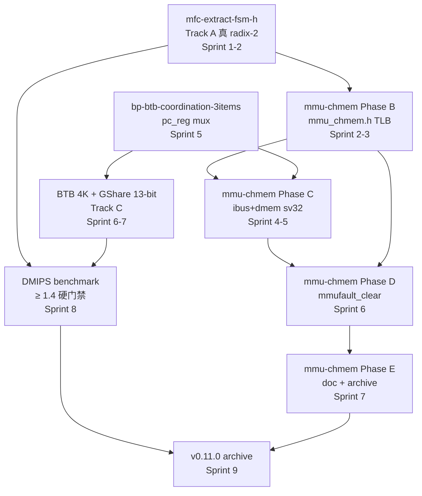

# Objective: objective-soc-cpu-v0110-launch

## 1. 驱动诊断（Why now）

Wave 5 (v0.10.x-v0.11.0) 是 ISA 覆盖 + 分支预测收官窗口。当前债务:

1. **rv32um 0/8 FAIL** — `ip/cpu/arch/riscv/mul_div_fsm.h:475-500` `advance_fsm` 是 ad-hoc busy counter 非真 radix-2 iterative (AGENTS.md L36 记录, defer v0.11.0, 注释自证 "Phase A 仅满足部分 ad-hoc enum switch 是过渡实现")
2. **dhrystone livelock** — [cpu-integration][dhrystone] 60s+ timeout, CPU mul/div FSM 问题 (commit 76ac53f "确认 livelock")
3. **MMU CH_MEM owner 真空** — `cpu_factory_chmem.h:80-85` 自证 "Real sv32 CH_MEM owner TBD", mmu-chmem-pipeline-integration Phase A 已 commit (a3afcfa) 但 B-E 待实施
4. **DMIPS/MHz 0.0351 距硬门禁 1.4 差 40x** — 需真 radix-2 + fetch stall + BP 协同

## 2. 目标愿景 + 完成判据

v0.11.0 launch 全绿 (HANDOFF §10 退出标准 + AGENTS.md 已知测试状态):

| 判据 | 当前 | 目标 |
|------|------|------|
| [riscv-tests] | 40/48 (rv32um 0/8) | **48/48** |
| [mmu] | 59/59 (Phase A 后) | 维持 |
| [cpu-l1-mmu-demo] | 6/6 | **7/7** (workaround 移除) |
| [mmu-verilator] | 3/3 (plumbing only) | **5/5** (真 sv32) |
| [cpu-integration] | 85 PASS + 8 rv32um FAIL + dhrystone livelock | **全绿** |
| DMIPS/MHz | 0.0351 | **≥ 1.4** (硬门禁) |
| 4 architecture gates | 维护 | **0 error** |

## 3. 架构依据

- ADR-083: Plugin-style 单一 source of truth (业务 IP 双编译模式 TLM/CH_MEM)
- ADR-082: negotiate 集成 (mfc Phase G)
- ADR-046: 多周期 FSM 豁免 (MUL/DIV FSM 化, `CF_PLUGIN_USE_FSM_EXEMPT`)
- ADR-040 v2.0: CH_MEM 是新正道 (mmu-chmem Phase B-E)
- RISC-V Spec §4.3.1: satp CSR encoding (mmu-chmem Phase A D4-A/D5-TLM)

## 4. 反例 + 应用边界（Anti-patterns + Scope）

**非目标 (out-of-scope, v0.11.0 窗口不实施)**:
- 不在 v0.11.0 窗口做 Sv39/48 MMU 完整翻译 (D1 收窄)
- 不做多级 TLB / LRU-RRIP / ASID≠0 (D1 out-of-scope)
- 不引入 CSR plugin (CH_MEM 物理不可能, Oracle R11)

**应避免的反模式**:
- "DMIPS 差 40x 直接上 dual-issue 修复" — R1 砍分叉,先真 radix-2 + fetch stall + BP 协同三件套,无效再考虑 dual
- "跳过 Phase B 直接 Phase C" — Phase B 的 mmu_chmem.h TLB 是 Phase C 依赖,跳 B 直接 C 必失败
- "BTB miss fallback 永久 static" — 仅 phase-4 软门禁过渡,v1.0.0 必须 GShare 实装

## 5. 风险（Risks）

| 风险 ID | 描述 | 缓解 |
|---------|------|------|
| R-RADIX-1 | mfc-extract-fsm-h 1-2 周估时是 Oracle 经验值,实装时可能发现 ch_state_machine DSL 边界 case | 留 1 周 buffer 在 Sprint 1 后段,bp-btb 启动期 |
| R-RADIX-2 | mfc team 双 P1 (mfc-cpu-pipeline-multi-cycle-fsm 50/60 + mfc-extract-fsm-h 15) 资源冲突 | owner 区分:Phase H archive 归前者,真 radix-2 归后者,共享 `MulDivFsmPlugin::negotiate()` 接续 |
| R-CHMEM-1 | mmu-chmem Phase C ibus_chmem.h 需要 fetch stall framework,目前未到位 | Phase C 启动前先 sprint `bp-btb-coordination-3items` (0.5d, mfc Phase C 入口对齐) |
| R-BTB-1 | BTB CoreMark 提升 < 10% (R1 砍分叉) | bp_mode 锁 static,启动 Learn 通路 RCA (双 sprint) |
| R-EXEMPT | `CF_PLUGIN_USE_FSM_EXEMPT` + waiver > 20 处 (R5 CI 豁免爆发) | MUL/DIV FSM 用 ch_state_machine DSL 不计入豁免数,每 Phase 不超 5 处新增 |

## 6. 假设（Assumptions）

1. Phase A 已 commit (`a3afcfa`, 2026-10-08) — Bare + shadow 修复 → [mmu] 59/59 实测维持
2. mfc-cpu-pipeline-multi-cycle-fsm 50/60 由原 owner 推到 Phase H archive (60/60),不依赖本 objective 的 mfc-extract-fsm-h 推进
3. Phase B-E 实施不修改 `cpu_factory_chmem.h:80-85` 占位注释("Real sv32 CH_MEM owner TBD") — owner 由 mmu-chmem-pipeline-integration archive 时同步清理
4. `bash tools/run_chipforge_tests.sh --all` 在 Phase B-E 推进期每 sprint 末跑一次回归,与 Sprint 复盘一并记录到 §11 跟踪台账

## 7. 依赖图（Dependency Graph）

## 8. 时间盒（Timeline）

**总时长: 17 周 (2026-10-09 → 2027-01-24)**

| 阶段 | 起 | 止 | 周数 | Track | 交付 |
|------|----|----|------|-------|------|
| Sprint 1 (mfc-extract-fsm-h 启动) | 10-09 | 10-22 | 2.0 | A | rdd-builder P0-P3 + 真 radix-2 iterative advance_fsm 实装 + rv32um 8/8 中检 ✅ 已 archive |
| Sprint 2 早期 (框架热身 + 排期对齐) | 10-23 | 10-30 | 1.0 | B | `ctrl-link-chmem-reg-handle` 纯框架 1d (stateful halt 通道 A1/A2 — Phase C.5 物理前置, **同时是 CppHDL API 热身 session**) + 排期对齐 1d + `feat-phase-6d-rtl-verification` 收官 1d |
| **Sprint 2-3 (mmu-chmem Phase B)** | **10-23** | **11-06** | **2.0** | B | Phase B 15d — `ip/mmu/plugins/MMUPlugin_chmem.h` (新) + `ip/cpu/plugins/mmu_chmem.h` (新) + `test_mmu_chmem_basic` 5 case + 集成回归。**2026-10-22 双审: 由 Sprint 6+ 提前; 估时 15d (非 10d — 原压缩版丢了 B.5 的 5d 集成回归)** |
| **Sprint 3 后段 (Phase 3.5)** | **11-06** | **11-30** | **3.5** | B | R11.1 trap PC 重审 0.5d + bp-btb 收窄 2 项 1d + fetch-stall v0.2 protocol 3d。**由原 pre_flight #2/#3 重构而来 (owner 已 defer ⇒ 无人可交付; 且 fetch-stall v0.2 反向依赖 Phase B)** |
| Sprint 4-5 (mmu-chmem Phase C + C.6) | 11-30 | 12-22 | 3.0 | B | Phase C wiring 5d (`mmu_exception_handler_chmem` / `cpu_factory_chmem` 注册 / `hazard_chmem` halt_when — **含 A4 mmufault 信号驱动**) + C.6 集成测试 3d |
| Sprint 6 (mmu-chmem Phase D) | 12-22 | 01-13 | 3.0 | B | Phase D 验证 5d (`[mmu-verilator]` TEST_CASE 4 sv32 e2e flip + `[cpu-l1-mmu-demo]` TEST_CASE 7 + `sv32-baseline-matrix.csv`) |
| Sprint 7 (Phase E 收官) | 01-13 | 01-24 | 1.0 | B | Phase E 文档 + archive (`mmu-chmem-phase-b-c-launch` + `mmu-chmem-pipeline-integration` 同步归档) + DMIPS ≥1.4 复验 + riscv-tests 48/48 |
| **复盘** | **01-24** | **01-31** | **1.0** | — | v0.11.0 archive 或 v0.11.x hotfix 决策 |

> **2026-10-22 双审调整说明**: ① 原 "Sprint 2-5 (Phase B-C)" 拆为 Sprint 2-3 (Phase B) / Sprint 3 后段 (Phase 3.5) / Sprint 4-5 (Phase C + C.6); ② Phase B 由 Sprint 6+ 提前到 Sprint 2-3 (根因 = 失败模式是 single-shot 派发方式而非日历位置, 由 Sprint 2 早期的 ctrl-link 热身 session 承接), 估时 10d → 15d; ③ 新增 Phase 3.5 slot 承载原 pre_flight 的 fetch-stall v0.2 + bp-btb 2 项 (原 owner wave5-bp-btb 已于 2026-10-19 S3 defer 到 v1.0.0 ⇒ 无人可交付); ④ **原 Sprint 7-8 的 BTB 4K / GShare 13-bit 已按 S3 决策移出 v0.11.0 窗口** (§8 表与 §10 候选此前未同步 S3, 2026-10-22 一并更正)。

**关键检查点**:
- **11-30 DMIPS 中检**:radix-2 跑通后 DMIPS 是否从 0.0351 上升到 ≥0.5(若 < 0.3 触发 R-RADIX-2 资源回收,转 focus 写测试不抢 BP)
- **11-06 Phase B 收口中检**:Phase B 15d 是否按 session 0/1/2 拆分推进;若 session 1 结束 `mmu_chmem.h` 仍未过编译 → 触发 R1 回退 (Phase B 后退到 Sprint 6-7, 本表 Sprint 2-3 行可整体后移)
- **01-13 riscv-tests 48/48 中检**:是否全部 ELF PASS(若仍有 FAIL 触发 R-CHMEM-1 defer 到 v0.11.x)
- ~~**12-15 BTB 命中率初检**~~:~~BTB 4K 装好后 vs static baseline 命中率增量~~ — **已按 2026-10-19 S3 决策移出 v0.11.0 窗口 (归 v1.0.0)**

## 9. 目标依赖与 Decision Gate

### 9.1 前置 objective 依赖
- `objective-ip-mmu-mmu-chmem-phase-b-e` — mmu-chmem Phase B-E 完成 (CH_MEM MMU 集成)
- `mfc-cpu-pipeline-multi-cycle-fsm` Phase H archive (50/60 → 60/60)
- `mfc-extract-fsm-h` 真 radix-2 实装 (rv32um + dhrystone 修)

### 9.2 Go / No-Go Decision Gate
- **Go 条件** (全部满足):
  - [ ] [riscv-tests] 48/48
  - [ ] [mmu] 59/59 + [cpu-l1-mmu-demo] 7/7
  - [ ] [mmu-verilator] 4/4  <!-- 2026-10-22 更正: 原写 5/5 有误 — 现状 3/3 plumbing-only baseline + D.1 新增 TEST_CASE 4 (sv32 e2e flip) = 4/4, 与 mmu-chmem-phase-b-c-launch proposal §Acceptance 一致 -->
  - [ ] [mmu][chmem] 5/5  <!-- 2026-10-22 新增: Phase B 的 test_mmu_chmem_basic (原 3 case → 5 case, 扩 Case 4 非恒等页表向量 + Case 5 Bare 隔离/satp 边界) -->
  - [ ] DMIPS/MHz ≥ 1.4
  - [ ] 4 architecture gates 0 error
  - [ ] `bash tools/run_chipforge_tests.sh --all` 全 PASS
- **时间触发器 No-Go 预览** (任一):
  - **11-30 DMIPS < 0.3** → R-RADIX-2 资源回收,BP 推进冻结 1 周
  - **12-15 BTB 命中率增量 < 5%** → R-BTB-1 砍分叉:bp_mode 锁 static,启动 Learn 通路 RCA
  - **01-13 riscv-tests 仍有 FAIL** → v0.11.0 archive 推迟,本 objective 翻 `v0.11.x hotfix` 修 mfc-extract-fsm-h 残留
- **No-Go 触发** (任一):
  - DMIPS/MHz < 1.4 且 01-13 复盘仍无明确修复路径
  - rv32um 01-13 仍有 FAIL

> **2026-10-19 决策 (S3)**: BP / CoreMark ≥1.9 不进 v0.11.0 硬门禁, 归 v1.0.0 窗口 (2027 Q3 已有规划 BTB + CoreMark ≥2.3)。本决策理由详见 §11 跟踪台账 + oracle session `ses_ead89ad2`。

## 10. next_sprint_candidates

**Sprint 1 (10-09 ~ 10-22, 2 周)**:
- `mfc-extract-fsm-h` P2 → P1,owner Wave5 mfc team,走 rdd-builder P0-P3 (HANDOFF §1 D1-D5 锁定)
- sub-task: 真 radix-2 iterative advance_fsm 实装(mul_div_fsm.h:475-500 重写)
- sub-task: rv32um 8/8 中检 → dl 临时跑 `bash tools/run_chipforge_tests.sh --riscv-tests`

**Sprint 2 早期 (10-23 ~ 10-30, 1 周)**:
- `ctrl-link-chmem-reg-handle` — CtrlLink stateful halt 通道 (纯框架 1d; stateful halt 通道 A1/A2 + `OR_combined_halt_conds()` + `should_*()` 契约; **A4 已移出 scope 改挂 Phase C.5**)
- 排期与归属对齐 (1d) — Phase B 窗口/工作量在 4 处文档对齐 + pre_flight 重归属 + planner-handoff 刷新
- `feat-phase-6d-rtl-verification` 收官 (1d) — E1-E14 核验 + E14 文档 + fragment 转 done

**Sprint 2-3 (10-23 ~ 11-06, 2 周)**:
- `phase-b-mmu-chmem-sv32` — `ip/mmu/plugins/MMUPlugin_chmem.h` 单级 ch_mem TLB + `ip/cpu/plugins/mmu_chmem.h` (15d: B.0 key 复用确认 + B.2 + B.3 + B.4 单测 5 case + B.5 集成回归)
- 协办:`feat-dhrystone-dmips-gate` — DMIPS 中检准备(11-30)

**Sprint 3 后段 (11-06 ~ 11-30, 3.5 周)**:
- `phase-3-5-fetch-stall-protocol` — R11.1 trap PC 重审 (0.5d) + bp-btb 收窄 2 项 (1d) + fetch-stall v0.2 protocol (3d); 挂载点 = C.4 入口条件

**Sprint 4-6 (11-30 ~ 01-13, 6 周)**:
- `phase-c-mmu-chmem-wiring` — C.1 / C.4 / C.5 (含 A4 mmufault 信号驱动) + C.6 集成测试
- `phase-d-mmufault-clear-combinational` — mmufault_clear combinational network (5d)
- `phase-e-mmu-chmem-archive` — 文档 + archive (2d)
- ~~`btb-4k-entry-baseline`~~ / ~~`gshare-13bit-pht-init`~~ — **已按 2026-10-19 S3 决策移出 v0.11.0 窗口 (归 v1.0.0)**
- `phase-e-mmu-chmem-archive` — 文档 + archive (2d)

## 11. 跟踪台账（append-only）
| Sprint | kind | 内容 | Decision/调整 | 原因 |
|--------|------|------|---------------|------|
| sprint-2026-10 | sprint-review | objective 创建 (Phase A 已 commit) | — | initial |
| sprint-2026-10-2 | objective-revision | R1-R5 5 处修订 + 17 周时间盒重排 | 12 周 → 17 周 | §8 R5 时间盒放宽 |
| sprint-2026-10-3 | objective-revision | **S3 决策: BP / CoreMark ≥1.9 不进 v0.11.0 硬门禁, 归 v1.0.0 窗口** | §6/§9.2/§10 v0.11.0 行 + phase-4 PoC-6 + strategy §3 wave5 同步刷新; v0.11.0 archive 时间盒 2027-01-24 → 2026-12 中下旬 (mmu-chmem archive 后 ≤1 周) | DMIPS 1.43 已由 `f95b2d0` dhrystone harness 修复 (不靠 BP); strategy §10 多数派不含 BP; v1.0.0 已规划 BTB + CoreMark ≥2.3; rollback 不对称 (A 错低成本 hotfix, B 错级联推迟数月); oracle session `ses_ead89ad2` Q1=A + Q3 17 项动作; 实施: rdd-quick `quick-bp-v0110-defer-2026-10` |
| sprint-2026-10-4 | objective-revision | **2026-10-22 双审后 Phase B 排期 + pre_flight 重构 + 4 处文档对齐** | ① Phase B 由 Sprint 6+ (12-01) **提前到 Sprint 2-3 (10-23 ~ 11-06)**, 估时 10d → **15d** (原 10d 压缩版整段丢失 B.5 的 5d 集成回归); ② 原 pre_flight #2 `fetch-stall-protocol-v0.2` + #3 `bp-btb-coordination-3items` **移出 pre_flight** → 合并为 **Phase 3.5 slot** (Sprint 3 后段 3.5d, 挂 C.4 入口条件); ③ §9.2 gate `[mmu-verilator]` 5/5 → **4/4** (原值有误: 3/3 baseline + D.1 新增 1 case) + 新增 `[mmu][chmem] 5/5`; ④ §8/§10 补同步 S3 决策 (BTB/GShare 此前未从 §8 表移除); ⑤ **新增 B-1 缺口** → 前置 change `chmem-mmu-keys-modality` (Phase B 的 B.3/B.4 硬前置) | Phase B 失败根因是 **single-shot 派发方式**而非日历位置 (源 change tasks.md 2026-10-10 注记: "超出 deep agent single-shot 30-min timeout 能力") ⇒ Sprint 2 早期 `ctrl-link-chmem-reg-handle` (同一套 `ch_reg` + OR 网 API 的交互式热身 session) 承接; 12-01 起只剩 8 周要塞 B(15d)+C(5d)+C.6(3d)+D(5d)+E(2d) ≈ 30d + DMIPS 硬门禁, buffer ≈ 0; pre_flight #2 的 owner (wave5-bp-btb) 已于 2026-10-19 S3 defer 到 v1.0.0 ⇒ 无人可交付, 且 `fetch_stall_requirements_v0.11.0.md` §1.5 BLOCKER-B5 明写 fetch-stall v0.2 **反向依赖 Phase B** ⇒ 逻辑倒挂; 决策纪要见 `.rddf/plans/20261022-v0110-mmu-chmem-execution-sequence.md` (仓内, 降级为非 SSOT) + oracle `ses_e9f5187c6ffejPjGSWRoK8KbvG` + metis `ses_e9f514d2dffeBCCPWtly985O3q` |
