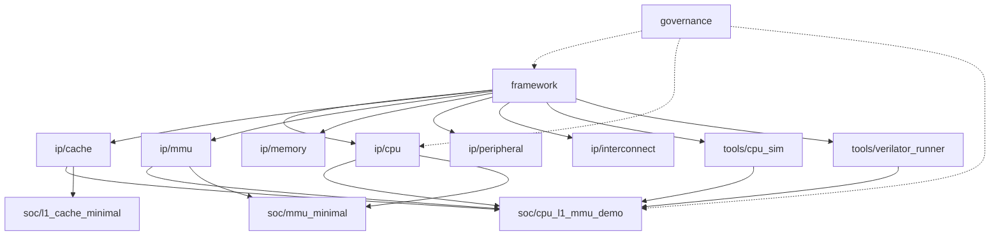

<!-- AUTO: feature fragments start -->

| id | status | phase_refs | theme |
|---|---|---|---|
| `feat-backend-parity-gate` | proposed | phase-4, phase-5 | 双后端差分 parity 门禁 —— 同一模型（CH_MEM）× 两后端（CppHDL Simulator / Verilator）差分执行 |
| `feat-bp-btb-gshare` | active | phase-4, phase-5 | 分支预测 BTB + GShare + RAS (PoC-6 CoreMark ≥1.9) — defer → v1.0.0 (2026-10-19 决策) |
| `feat-dhrystone-dmips-gate` | done | phase-4 | Dhrystone DMIPS/MHz ≥1.4 硬门禁 (mfc Phase G) — ✅ archived 2026-10-15 |
| `feat-mfc-multi-cycle-fsm` | active | phase-2, phase-4 | MUL/DIV FSM 化 + ADR-082 negotiate 集成 |
| `feat-mmu-chmem-integration` | active | phase-4 | CH_MEM MMU/PTW pipeline 集成 (v0.11.0 owner) |
| `feat-phase-6d-rtl-verification` | active | phase-4 | Phase 6d 5-stage Pipeline CH_MEM + Verilator + MMU/PTW FSM (跨 cpu/mmu/cache) |
| `feat-rv32um-m-extension` | active | phase-4 | RV32UM M 扩展真实 radix-2 覆盖 (rv32um 8/8) |
| `feat-rv64-isa-declaration-integrity` | active | phase-4 | RV64 ISA 声明真实性 + XLEN 就绪度门禁 (ADR-087 实施) |
| `feat-tlm-backend-retirement` | active | phase-4, phase-5 | TLM 后端退役 — CH_MEM 单后端收敛 (冻结 → 承载力 → 语义裁决 → 删除) |

_auto-generated by `rddf roadmap --update-agent-md` — DO NOT hand-edit this block_
<!-- AUTO: feature fragments end -->

# ChipForge — Agent 简明手册

本项目用 **Plugin-style**（D4 决策）设计所有硬件 IP（单一 source of truth, 详见 [ADR-083](docs/architecture/adr/ADR-083-plugin-style-single-source-of-truth.md)）。**业务 IP 不再分别维护 TLM 副本和 RTL 副本**——同份 Plugin-style 代码经由**两个编译模式**产出不同仿真后端：

| 模式 | 编译开关 | `uint_t<N>` 解析为 | 调度入口 | 仿真后端 |
|------|---------|-------------------|---------|---------|
| **TLM** | 默认（不加 flag） | POD (`uint8_t`/`uint16_t`/`uint32_t`/`uint64_t`) | `pb.run()` 每周期执行 | C++ 直仿（~0.6s 全套） |
| **CH_MEM** | `-DCF_PLUGIN_USE_CH_MEM` | `ch::core::ch_uint<N>` | `pb.elaborate(ctx)` 发射 lnode DAG | ① CppHDL Simulator ② `ch::toVerilog(ctx)` ③ Verilator 联合仿真 |

**CppHDL 是 Plugin-style 的底层设施**（提供 ch_uint / ch_reg / ch_mem / lnode DAG / toVerilog / Verilator backend / `ch_stream<T>` bundle）。**CppTLM 是 legacy 仿真内核**，仅 `src/cf_plugin/bridge/` 适配层依赖——★ **业务 IP 不使用 CppTLM 的组件范式**（`Module` / `Port` / `ModuleFactory` / `ChStreamModuleBase` / `StreamAdapter`）；★ **CppHDL 的 `ch_stream<T>` 可用**（用于 **IP 之间 / 核 ↔ 从设备**的接口连接；核内 stage 间仍用 `Payload<T>`）⇒ 详见 **ADR-083 v1.2 §4.2** / **ADR-092 §D4**。

---

## 路线图 primary scope 隐式语义 (2026-10-19)

`.rddf/roadmap/{objectives,phases}/` 下文件命名约定：

- **后缀 `-<primary_scope>` 表达"主视角"**：当 objective/phase 跨多个 IP scope 时, 文件名后缀标注其"以哪个 scope 为主要视角"实施
- **frontmatter `primary_scope:` 字段** = 主视角 (6 值枚举: `ip-cpu`, `ip-mmu`, `ip-cache`, `soc-cpu`, `soc-mmu`, `soc-cache`)
- **frontmatter `co_scopes: []` 字段** = 协同 scope 列表 (跨 scope 实施时列出)
- **范围对齐**: `primary_scope` 枚举与 AGENTS.md §2 scope matrix 5 categories (framework / ip / soc / governance / tools) 正交独立
- **典型示例**:
  - `phase-1-ip-cpu.md` → primary: cpu (v0.7.0 CPU pipeline 清债, 不跨 scope)
  - `phase-2-ip-mmu.md` → primary: mmu, co: [cpu] (v0.8.0 MMU 实内存 + 周期精度涉及 cpu pipeline 集成)
  - `phase-4-soc-cpu.md` → primary: cpu, co: [mmu] (v0.10.x-v0.11.0 Wave 5 cpu 主 + mmu 协同)
  - `objective-soc-cpu-v0110-launch.md` → primary: cpu, co: [mmu] (v0.11.0 launch 跨 cpu + mmu, cpu 是 launch owner)
- **范围一致性**: feat-*.md 已有 `scope:` 字段 (cpu / cache / mmu / soc / cross, commit 9af06e8), objective/phase 用更精确的 primary+co 表达
- **历史失同步**: `openspec/changes/archive/*` 内部仍引用旧名, 已知且用户接受 (2026-10-19 决策); 旧名仅作为 git history 留档

### 路线图文档命名空间结构

```
.rddf/roadmap/
├── strategy.md              (单文件, 跨 scope SSOT)
├── phases/
│   ├── phase-1-ip-cpu.md    (primary: cpu, v0.7.0)
│   ├── phase-2-ip-mmu.md    (primary: mmu, co: cpu, v0.8.0)
│   ├── phase-3-ip-cache.md  (primary: cache, co: cpu, v0.9.0)
│   ├── phase-4-soc-cpu.md   (primary: cpu, co: mmu, v0.10.x-v0.11.0)
│   └── phase-5-soc-cpu.md   (primary: cpu, co: mmu+cache, v1.0.0+)
├── features/
│   └── feat-*.md            (frontmatter scope: cpu|cache|mmu|soc|cross, commit 9af06e8)
└── objectives/
    ├── objective-ip-mmu-mmu-chmem-phase-b-e.md  (primary: mmu)
    ├── objective-soc-cpu-v0110-launch.md        (primary: cpu, co: mmu)
    ├── objective-soc-cpu-v100-launch.md         (primary: cpu, co: mmu+cache)
    ├── objective-soc-cpu-v120-launch.md         (primary: cpu, co: cache+mmu)
    └── objective-soc-cpu-v130-launch.md         (primary: cpu, co: cpu+mmu+cache)
```

---

## 构建与测试

```bash
# 标准配置 + 构建（首次自动 ExternalProject build CppTLM/CppHDL 到 build/_deps/install/）
cmake -S . -B build -DCMAKE_BUILD_TYPE=Debug
cmake --build build -j$(nproc)

# 跑全部测试（4 个 ctest entry：TLM + CH_MEM + Verilator smoke + 架构 gate）
ctest --test-dir build --output-on-failure
# 或封装脚本（默认 = TLM only; --all = 全量 ~167s）
bash tools/run_chipforge_tests.sh --all

# 按 family tag 过滤
./build/bin/chipforge_tests "[framework]"       # Plugin 框架 (TLM, ~0.6s)
./build/bin/chipforge_tests "[cache]"            # L1Cache IP
./build/bin/chipforge_tests "[cpu-integration]"  # RISC-V 集成
./build/bin/chipforge_tests "~[mmu]"             # 排除某 family

# CH_MEM family（必加 -DCF_PLUGIN_USE_CH_MEM 才 build 出此 binary）
./build/bin/chipforge_tests_chmem "[chmem]"
./build/bin/chipforge_tests_chmem "[verilator]","[mmu-verilator]"  # Verilator 后端完整 (4 cases)

# Phase 6d.5 E8 standalone Verilator runner（开发者 debug 入口，从仓库根运行，ELF 为相对路径）
./build/bin/cpu_verilator_sim --elf tests/cpu/riscv_tests/elf/rv32ui-p-add
```

### 已知测试状态

> **数字维护原则 (v0.10.0 起)**：每次发布前由 `bash tools/v0100-bootstrap.sh review` 输出 §honesty_audit 段重新核对；文档数字与 ctest 实测一致时再 commit。CHANGELOG §Verification 段数字必须基于 HEAD commit 实测，禁止快照引用。

- **MMU 测试已重新启用**（`tests/CMakeLists.txt`，mmu-tlb-ptw-impl commit 10）：`[mmu]` **59/59 PASS**（145 assertions, v0.11.0-prep 实测），含新增 `[bare-shortcut]` 3 case + `[shadow-bug]` 3 case（PR2-A 收尾 2026-10-10，commit `a3afcfa` 锁定）。**v0.10.0 hotfix 后**：debug-cpu-l1-mmu-demo-paddr-regression archive 修复 MMU Bare shortcut 退化（sv_mode_==Bare || satp_ppn_==0），同时修 [cpu] + [cpu-integration] 5 个回归。**v0.10.4 完整收官**（2026-09-30 `debug-mmu-cache-end-to-end-bridge-regression`，uncommitted）：`ad48fcf` 仅在 `MMUPlugin` 引入 `satp_value_` 字段注释"Bare shortcut 严格判定用"，但 `do_lookup` 实际仍用 `satp_ppn_==0` 误判 —— Sv-mode + satp_ppn=0 也走 identity translation（vaddr 当 paddr），破坏 `tests/cache/test_mmu_cache_integration.cpp` `[cache][MMUCacheIntegration] EndToEndTranslationThroughBridge` (prefill TLB → lookup → hit → paddr=0x80000000)。完整修复：(1) `MMUPlugin::do_lookup` Bare shortcut 改用 `satp_value_` MODE 字段判定（与字段命名一致：Sv32=bit31、Sv39/48=bit[63:60]、Bare=0）；(2) `MMUPlugin` ctor 按 `sv_mode_` 自动编码 `satp_value_` 初值，让桥路径与 `RiscvMMUPlugin` ctor 路径行为一致。**v0.11.0-prep `a3afcfa` 完整收官**（2026-10-08）：在 `ad48fcf` 基础上删 `MMUPlugin.cpp:109` 析取项 `|| satp_ppn_ == 0`、删 `mmu.h` 派生三件套（`set/get satp_value` shadow + 重复 `satp_value_` 成员）、`mmu.cpp:37` 改用 `cf::cpu::detail::extract_satp_ppn` mode-aware mask（22-bit Sv32 / 44-bit Sv39/48 排除 MODE bit31）。**实测验证**（2026-10-10 PR2-A 收尾）：`[bare-shortcut] 3/3`、`[shadow-bug] 3/3`、`[mmu] 59/59`、`[cpu] 129/129`、`[cpu-l1-mmu-demo] 6/6` 0 不退化；架构门禁 `verify_adr 0 fail` / `verify_plugin_decision 8/8` / `check_plugin_portability 13/13` 全 PASS。
- **`[keys]` 新增 4 case（`chmem-mmu-keys-modality`，2026-10-22，**CH_MEM binary**）**：`tests/mmu/test_mmu_keys_modality.cpp` — MMU payload key 模式化 + CH_MEM 生产者/消费者顺序契约的**机制锚**。4 case / **15 assertions**：① 编译期断言 5 个 key 的 cell 类型 ≡ `ch_uint<1>/<8>/<64>`（裸类型 key 下 **RED = 编译失败**，证据见 change tasks.md §1.3）② 鉴别力：consumer 读到**同一 DAG 节点**（`impl()` 指针相等）且 **6 拍内 ≥5 次翻转** ③ 顺序契约：consumer `EARLY` / producer `LATE` ⇒ `has()` false ④ 变异对照可检测性（冻结常量 0 翻转 vs 活节点 ≥5 翻转；读错 key ⇒ `has()` false）。**3 个真实变异全部被抓住**（消费端折常量 → 2 断言 RED；读错 key → 2 断言 RED；顺序倒挂 → 1 断言 RED）。CH_MEM 全量随之 **114 → 118 case / 19622 → 19637 assertions**，All passed。
- **7stage 测试 PASS（已修复）**：`7stage_add_elf_end_to_end` 原 segfault 根因已由 commit `b82af0f`（CpuFactory 7stage superscalar `lane_counters` use-after-free）修复；`[cpu-integration]` 全 81/81 case PASS（含 3 个 `7stage*` Catch2 filter 命中 + 2 个大写 S 命中（`build_7stage_superscalar` / `EnableMMU7StageCommitRetire`），合计 5 个 case 名称含 "7stage"）。**CWD 约束**：`test_7stage_riscv.cpp` 通过 `exec_cmd("./build/src/cf_plugin/cpu_sim ...")` 调用 cpu_sim（相对路径），ctest `WORKING_DIRECTORY=${CMAKE_SOURCE_DIR}`（`tests/CMakeLists.txt:101`）保证 PASS；从 CWD ≠ 仓库根（含 `build/` 子目录）直接执行 binary 会因相对路径解析失败误报 FAIL。务必用 ctest 或从仓库根运行。
- **`[riscv-tests]` 48/48 PASS**（`test_rv32ui_runner.cpp` 40/40 + `test_rv32um_runner.cpp` 8/8, 基线见 `soc/cpu/docs/dse/rv32{ui,um}-baseline-matrix.csv`, 2026-10-13 HEAD `c277799` 实测）：P0#2 `cpu-pipeline-fix-rv32ui-load-width`（commit `8909165`，v0.6.0 提前归档）补完 DBusPlugin LOAD width extraction（funct3=000/001/010/100/101 LB/LH/LW/LBU/LHU + sign/zero extension + RD_DATA forwarding），原 10 个 LOAD-family 用例（lb/lbu/lh/lhu/lw + 内嵌 load 的 sb/sh/sw/ld_st/st_ld）从 stub FAIL 转为 PASS。**rv32um 真 radix-2 iterative 实装落地**：`mfc-extract-fsm-h` change（OpenSpec `archive/2026-10-10-mfc-extract-fsm-h/`，commit `df3bcea` merge 入 main）—— `ip/cpu/arch/riscv/mul_div_fsm.h:207-274` `advance_fsm` 实装真 radix-2 iterative（mul=1-cycle / mulh=3-cycle / div=33-cycle 逐 bit 恢复除法），8 ELF（mul/mulh/mulhsu/mulhu/div/divu/rem/remu）实测 cycles 与 CSV 基线 1:1 对齐（mul=455 / mulh=504 / div=380 / rem=380）。**v0.11.0 launch gate 判据 #1**（`objective-soc-cpu-v0110-launch.md §8 Sprint 1`）：rv32um 8/8 ✅ 兑现。**剩余 v0.10.0 收官工作**：mfc-cpu-pipeline-multi-cycle-fsm 已 archive（2026-10-16, commit `07cf77c`），其 D.4/F/G/H 12 task 推迟；`mfc-extract-fsm-h`（commit `df3bcea`, archived 2026-10-10）已兑现 advance_fsm 真 radix-2 iterative + fsm.h 抽取；wave5-bp-btb（DMIPS/MHz ≥1.4 硬门禁）仍未启动，独立 tracking。
- **`cpu-sim-add-elf-tohost-fix` change (v0.10.1 目标, 2026-10-12 实测, 2026-10-14 archived, scope partial)**：落地 `tests/README.md §3.2` 描述的 cpu_sim 工具层 workaround，让 5 个 cpu_sim CLI 测试转绿。**已落地**：(1) `tools/cpu_sim/main.cpp` 新增 `--tohost-addr` CLI flag；(2) `tests/cpu/manual_elf/link_add.ld` 新建（riscv-tests 风格, base=0x80000000, tohost symbol @ 0x80001000）；(3) `add.S` 改用 `la x5, tohost; sw x4, 0(x5)` 风格；(4) `build_manual_elf.sh` + `src/cf_plugin/CMakeLists.txt` per-ELF linker 路由（仅 add 用 link_add.ld，mmu_bare/l1cache_basic 仍用 link.ld 保持向后兼容）；(5) 5 个测试 (`test_cpu_sim_real_tohost` + 4 个 `{3,5,7,10}stage_add_elf_end_to_end`) 更新 exec_cmd 调用约定。**实际结果**（2026-10-12 实测）：5 个测试**仍 FAIL** — 工具层 workaround **未**修复根因。**真根因 defer → 已诊断 → 已修复**：
  - **2026-10-15** `cpu-pipeline-tick-rca` (commit `23783a3` archived) P2 实测确诊 F1+F2+F3 三层复合根因：（**F1**）`load_config()` 静默丢 `enable_mmu` 等 8 字段；（**F2**）4/5 测试 config 显式 `enable_mmu:true` 与裸机烟测本意不符；（**F3**）`enable_mmu=true` + satp 未编程 + Bare-shortcut 严格化（v0.10.4 `a3afcfa`）+ PTW 永不 inactivate → fetch 永 stall。**非**framework-level bug —— C++ API 路径 48/48 PASS 已证 pipeline tick 机制可达，差异只在 CLI 输入侧。
  - **2026-10-16** `cpu-pipeline-tick-fix` (commit `082b07a` archived) 修复完成 F1+F2+F3a+F3b 4 路径 + D4 硬约束（保持 `CPUConfig::enable_mmu=true` 默认）。**当前 `[cpu]` 综合状态**：**129/129 PASS**（5 cpu_sim CLI fail→pass，0 FAIL）；**`[cpu-integration]` 综合状态**：HEAD `4e5ae36` 实测 33/36 PASS（4 add_elf end-to-end + 1 test_cpu_sim_real_tohost fail→pass；3 baseline-known FAIL 中 1 个 infra drift 与本 fix 无关：`test_7stage_riscv.cpp:124` node_count==17 infra drift）。**0 regression 实测**（HEAD `4e5ae36`）：`[riscv-tests] 48/48` (461+48 assertions), `[mmu] 59/59` (146+146 assertions Bare-mode byte-identical 锚点), `[cpu-l1-mmu-demo] 6/6`, `[cpu-integration][mul-div-fsm-integration] 4/4`, `[cache] EndToEndTranslationThroughBridge` PASS (v0.10.4 hotfix 维持). 架构门禁 33+8+12 全 PASS。
- **历史注解 (dhrystone baseline FAIL 已不在 baseline-known 列表)**: `test_dhrystone SIGTERM 1` + `DMIPS gate 1` 已于 2026-10-15 由 commit `f95b2d0` (dhrystone harness 3 层契约违反修复) + archive `2026-10-15-feat-dhrystone-dmips-gate` 闭环, DMIPS 0.0351→1.43 突破 ≥1.4 硬门禁。本行仅为时间线注解, 不再作为 baseline-known FAIL 计入 `[cpu-integration]` 综合状态。
  - **解锁路径**: `feat-dhrystone-dmips-gate` (DMIPS/MHz ≥1.4 硬门禁) + `feat-bp-btb-gshare` (PoC-6 CoreMark ≥1.9) 测量底座 = cpu_sim 修绿 → 可信. v0.11.0 launch gate §8 Sprint 1 **判据 #2 (5 cpu_sim CLI PASS) 直接兑现**.
- **`[cpu-l1-mmu-demo]` 6/6 PASS**（`tests/soc/soc-cpu-l1-mmu-demo/test_cpu_l1_mmu_demo.cpp`，v0.10.2 实测维持 workaround）：CPU+MMU+Memory 结构验证 demo。**v0.10.1 deep-rca (`debug-cpu-l1-mmu-demo-deep-rca`)** 修复: 测试 `cfg.enable_mmu=false` (与 `test_rv32ui_runner.cpp:109` 对齐, 走 Bare translation); root cause `ip/cpu/cpu_factory.h:390` 硬写 `/*satp_value=*/0` 让 `cfg.mmu_mode="sv32"` config inert (MMU plugin 注册但 PTW 从不在-window 0x0 读 PTE, 退化为 Bare mode 但与无 MMU 路径产生语义差)。**v0.10.2 cpu-factory-satp-mapping** (`openspec/changes/archive/2026-09-28-cpu-factory-satp-mapping/`) 落地 infrastructure 修复 `cpu_factory.h:390` (helpers + ctor propagation + plant helper + unit test 9 assertions PASS)。**Part (a) MMU exception handler 已由 `cpu-pipeline-mmufault-handler` v1 archive 落地** (HazardPlugin::clear_mmufault + MmuExceptionHandlerPlugin TLM/CH_MEM)。`add`/`addi`/`auipc`/`jal`/`beq` 全部到 tohost=1 within 10000 cycles via workaround. L1CachePlugin 仅 JSON 声明不实例化（deferred to Wave 3 cache-dse-sweep）。**Follow-up**: 真 sv32 translation 测试 (b) flip `cfg.enable_mmu=true` 在本测试（独立跟踪，依赖 Part (a) v1 archive + 真 MMUPlugin CH_MEM 实装 Phase 6d.6）.
- **`[cpu-pipeline-mmufault-handler]` `1 change` (v0.10.x wave5 P1 owner, IN_PROGRESS)**：CPU pipeline 卸载 MMU exception handler. HazardPlugin::clear_mmufault() API + MmuExceptionHandlerPlugin TLM + cpu_factory 联动 (TLM + CH_MEM, CH_MEM 用 `#ifndef CF_PLUGIN_USE_CH_MEM` 守护). Part (a) of v0.10.1 deep-rca follow-up, 为真 sv32 e2e 翻转铺路. Phase 7-12 (spec + doc + archive) 待 archive 时合并为最终 entry.
- **P0#1 `cpu-pipeline-canonical-ordering-assert` 已落地**（v0.7.0, ADR-048）：`register_early_plugins()` 现在在 IBusPlugin 之前注册 MMUPlugin，并通过 `check_canonical_ordering()` 运行时断言验证。4 个 `[cpu-integration]` canonical_ordering 测试 PASS（实现走运行时断言而非原 proposal D1=A `static_assert`，因 `inline int` 非 constexpr；spec.md / archived proposal §3 仍提 `static_assert`，属 archive drift，已在 §3 注释 + spec 标注）。

### 构建模式

| 场景 | 命令 | 说明 |
|------|------|------|
| 默认（快速） | `cmake -B build && cmake --build build` | CppTLM/CppHDL 已 install 时跳过 build |
| 重 build 依赖 | `-DCHIPFORGE_REBUILD_DEPS=ON` | CppTLM/CppHDL 源码修改后需要 |
| 源码调试 | `-DCHIPFORGE_SOURCE_DEPS=ON` | add_subdirectory 嵌入模式，改 API 即时生效 |
| ASan | `-DENABLE_ASAN=ON -DCMAKE_BUILD_TYPE=Debug` | 调试 |
| 完全重置 | `rm -rf build/_deps` | 从零开始重建 deps |

---

## 架构核心约束（D4 / ADR-040 v3.0）

**所有业务 Plugin 必须遵守**（CI 强制执行，`tools/verify_plugin_decision.sh` + `tools/check_plugin_portability.sh` 13/13 PASS）：

1. **无 `void tick()`** — `PluginBase::tick() = delete`，bridge 适配层例外（`src/cf_plugin/bridge/`）
2. **无状态机** — 禁止 `enum class State` + `switch(state_)`；**多周期协议引擎**豁免（ADR-046：`CF_PLUGIN_USE_FSM_EXEMPT` + `chlib::ch_state_machine` DSL）
3. **Bundle 字段用 `cf::plugin::uint_t<N>`** — **TLM 模式**是 POD；**CH_MEM 模式**是 `ch::core::ch_uint<N>`（ADR-040 v2.0 翻转）
4. **`at_stage` 回调内无 `if (cond) return;` 早返** — 用 `if (cond) { ... }` 包裹主逻辑
5. **TLM 文件（`<name>.h`）不含 `ch_mem`/`ch_reg`/`ch_uint`/`ch::core`**；**CH_MEM 文件（`<name>_chmem.h`）必须含 `ch_*`**（`#ifdef CF_PLUGIN_USE_CH_MEM`）— `check_plugin_portability.sh` Check 2/7 强制
6. **`Plugin::build()` 内不调 `pb.run()`** — TLM 模式 `pb.run()` 每周期仿真；**CH_MEM 模式 `pb.elaborate(ctx)` 一次性发射 lnode DAG**（v0.3.0+ 是新正道）
7. **存储优先用 `cf::plugin::storage::array_store`** — TLM 单缓冲 / CH_MEM 双缓冲 commit swap（ADR-040 Tier-2 推荐）
8. **at_stage 回调内禁运行期 `if(ch_bool)`** — `ch_bool::explicit operator bool()` + C++17 contextual conversion **编译期通过**但**静默取 false**，靠 CI grep 兜底（`check_plugin_portability.sh` Check 5）
9. **PayloadStore fail-fast**: `const T& get(key)` 在 cell 缺失时**抛异常**（v0.3.1 M6 修复），写路径仍 emplace-on-miss（`check_plugin_portability.sh` Check 8）
10. **Payload key 必须 mode-aware** — key 的 value type 用 `cf::plugin::uint_t<N>`，**禁**裸 `bool`/`uintN_t`。CH_MEM 下裸类型 cell 只能装 **POD 常量**（`put` 是精确类型匹配），消费端读到的就是 elaboration 期快照 ⇒ **信号退化为常量 ⇒ 测试全绿但语义为零**（ADR-040 v3.0 §10.5；`check_plugin_portability.sh` Check 13，WARN-only + allowlist）
11. **mode-aware 还不够 —— 生产者必须直写 ch 节点** — key 类型对了但生产者把表达式折成 POD（`static_cast<bool>` / `static_cast<uint64_t>`）时，cell 里仍是 **elaboration 期常量** ⇒ 消费端 `select()` 的条件恒定 ⇒ **不产生任何编译/运行期错误**。正确写法：`ch_uint<1>(<ch_bool 表达式>)`（走上游 `bool_to_uint` 分支 ⇒ 复用同一 `impl()` 指针）。判据：cell 的 `impl()->is_const()` 必须为 `false`（ADR-040 v3.0 §10.5 + capability `payload-key-modality`）
12. **跨 stage payload 的顺序契约** — CH_MEM 下 `elaborate()` 只跑一遍，cell 里是「C++ 侧重绑的指针」⇒ **生产者必须先写**。唯一不依赖插件注册顺序的写法：**同一 stage 名**，生产者 `Phase::EARLY` / 消费者 `Phase::NORMAL`；生产者**禁**注册新 stage 名（`canonical_stage_order()` 只看 stage 名字首现序），需要 node 用 `declare_substage`（ADR-040 v3.0 §10.6）

### 编译开关

| 模式 | 编译选项 | `uint_t<N>` 实际类型 | 适用场景 |
|------|----------|----------------------|----------|
| **TLM**（默认, 兼容） | 不加 flag | POD (`uint8_t`/`uint16_t`/`uint32_t`/`uint64_t`) | Phase 0-1 业务代码、单元测试、TLM baseline |
| **CH_MEM**（v0.3.0+ 新正道） | `-DCF_PLUGIN_USE_CH_MEM` | `ch::core::ch_uint<N>` | Phase 6c+ 新 Plugin、elaboration 验证、Verilog 生成 |

业务代码**必须双文件分离**:
- `ip/<area>/<name>/<name>.h` — TLM 模式（总是编译）
- `ip/<area>/<name>/<name>_chmem.h` — CH_MEM 模式（仅 `#ifdef CF_PLUGIN_USE_CH_MEM` 包裹）

详细纪律见 [`docs/lessons/phase-6c-elaboration-substrate.md`](docs/lessons/phase-6c-elaboration-substrate.md)（15 类陷阱 + 7 个模式 + 8 项检查清单）。

---

## 代码组织

### 项目骨架

| 目录 | 内容 | 状态 |
|------|------|------|
| `ip/{cpu,cache,mmu,memory,...}/` | 硬件 IP，每个独立，`plugins/` (双文件) + `lib/` 切分（ADR-083 单一 source of truth） | 不同 IP 不同阶段 |
| `include/cf/plugin/` | Plugin 框架头文件（PluginBase/Payload/PipeNode/PipeBuilder/CtrlLink） | ✅ Phase 0 完成 |
| `src/cf_plugin/bridge/` | Bridge 适配层（CppTLM ↔ Plugin 桥接） | ✅ L1Cache 完成 |
| `tests/{framework,cache,cpu,mmu,soc,bundles}/` | 测试按 family 分目录，非按源码位置 | |
| `bundles/` | 共享 Bundle 定义（`mem_bundles.h`, `tlb_bundles_extension.h`） | |
| `soc/` | SoC 级 JSON 配置 + 系统架构文档（`soc/cpu/docs/architecture.md` + `.rddf/roadmap/`） | |
| `docs/` | 架构文档、ADR、流程图、框架级路线图（Phase 0/6） | |
| `openspec/changes/` | OpenSpec 变更工作区 | |
| `openspec/specs/` | OpenSpec 跨 change 规范 | |
| `.omo/` | 历史决策草案、实施计划 | |
| `build/` | **CppTLM/CppHDL deps 在 `build/_deps/install/` 下** | |

### 测试家族

| Family tag | 目录 | 内容 | 数量 |
|-----------|------|------|------|
| `[framework]` | `tests/framework/` | Plugin 基础组件（TLM 模式） | 124/124 PASS, 341 assertions（2026-10-20 实测；含 `[arith-poc]` 22 case 白盒 PoC） |
| `[chmem]` | `tests/framework/` + `tests/cpu/` + `tests/mmu/` | CH_MEM 模式 elaboration + PoC + vendored ELF + MMU TLB + CPU/CSR key 模态 | 123 case = **123/123 PASS**（2026-10-27 实测；★ 随全套 164 case / 20133 assertions 全绿；`chmem_vendored_elf_tohost1` 内 10 个 rv32ui load/store ELF 已由上游 CppHDL `c27543d` 修复；vendored_elf 47 section = 39 rv32ui 全 PASS + 8 rv32um 全 PASS）。另 `[arith-poc]` 24 case 白盒全 PASS + `[alu][semantics]` 6 case / 288 assertions（CH_MEM ALU 单元级语义锚，真跑 19 层 select 树）+ `[keys]` 4 case + `[mmu-chmem-basic]` 7 case + `[cpu-chmem-keys]` 5 case |
| `[chmem-config]` | `tests/cpu/schema/test_cpu_config_chmem.cpp` | CH_MEM CPU 的 **JSON 配置面**契约（P2）—— 默认值对齐 `build_cpu` · 两种 JSON 形态 · 32 项 TLM-only 字段**逐个带原因拒绝** · 未知字段被拒 · 类型错/值域/文件缺失/语法错各自独立 `ErrorKind` · schema 与拒绝表**双向一致** | **14/14 PASS, 254 assertions**（2026-10-27 实测）；★ **归属 `chipforge_tests`（TLM binary）** —— ⚠️ **不在** `chipforge_tests_chmem`（★ `CHMEM_TEST_SOURCES` 是**显式列表**，不含本文件 ⇒ 实测 CH_MEM binary 331 case 里 0 个「chmem config」case） |
| `[cpphdl]` | `tests/framework/test_cppHDL_hello_poc.cpp` | CppHDL 完整链路（ch_device/toVerilog/Simulator） | 6/6 PASS, 15 assertions |
| `[elaborate]` | `tests/framework/` | PipeBuilder::elaborate() 4 API PoC | 全部 PASS |
| `[verilator]` | `tests/cpu/test_cpu_verilator_sim.cpp` *(在 `chipforge_tests_chmem`)* | Verilator 后端 48-ELF (40 rv32ui + 8 rv32um) suite tohost=1 | 1/1 case PASS (**48 ELF, 96 assertions, 全 PASS** — 2026-10-20 实测；含 8 rv32um 真 PASS，判据为严格 `TOHOST=1`，非 mask 假绿)。**历史（供追溯）**：2026-10-14 `verilator-mul-div-fsm-followup` 曾加 `& 0x1u` mask 对齐 riscv-tests harness 的 fail 协议（`gp = test_num \| 1`，LSB=1 表 fail）→ 造成"8/8 假绿"；2026-10-20 `8aa0314` 二次修订拆 done/pass 双判据 + TIMEOUT 三态，runner 恢复严格判定。**旧归因更正**："上游 CppHDL `ch_uint` 算术语义异常"已被 PoC `63bfc8a`/`03667fa` **证伪**（`14/4=3`、`3*4=12`）—— 真根因是 CH_MEM 数据通路未实现 M-op，已由 `chmem-mext-comb-datapath` 组合式落地修复。**cycle 不可比**：组合式 M-op 1 拍出结果，与 TLM radix-2（MUL=1c/MULH=3c/DIV=33c）不同构 → cycle parity 判据不适用，移交 `chmem-mext-fsm-cycle-parity` |
| `[mmu-verilator]` | `tests/mmu/test_mmu_bare_plumbing_verilator.cpp` *(在 `chipforge_tests_chmem`)* | Verilator 链路 MMU Bare 模式 plumbing (Phase 6d P2) | 3/3 case PASS (5 ELF cycle cap + elaboration + manual_elf), 26 assertions |
| `[cache]` | `tests/cache/` | L1CachePlugin + Bridge + Adapter（5 个） | 25/25 PASS, 71 assertions（2026-10-27 实测） |
| `[cpu]` | `tests/cpu/` | CPU Plugin 单元测试 | 137/137 PASS, 480 assertions（2026-10-27 实测） |
| `[cpu-integration]` | `tests/cpu/integration/` | RISC-V 多 stage 集成（4 个） | 95/96 PASS, 65739/65740 assertions（2026-10-27 实测；★ 1 fail = `7stage_topology_from_config` **既存** infra drift，见 §已知测试状态） |
| `[soc]` | `tests/soc/` | SoC JSON 拓扑 | 20/20 PASS, 179 assertions（2026-10-27 实测） |
| `[bundles]` | `tests/bundles/` | Bundle 定义测试 | 9/9 PASS, 39 assertions（2026-10-27 实测） |

> **测试 binary 归属（Oracle 2026-10-06 修订）**:
> - `[framework]`/`[cache]`/`[cpu]`/`[cpu-integration]`/`[soc]`/`[bundles]`/`[mmu]`/`[riscv-tests]`/`[cpu-l1-mmu-demo]`/`[tlb-refill]` — 全部在 `chipforge_tests` (TLM binary)
> - `[chmem]`/`[cpphdl]`/`[elaborate]`/`[verilator]`/`[mmu-verilator]` — **全部在 `chipforge_tests_chmem`** (CH_MEM binary, `-DCF_PLUGIN_USE_CH_MEM`)
> - **推荐运行**:
>   - TLM 快速回归：`./build/bin/chipforge_tests` (★ **514 catch2 instances / 67463 assertions / ~2m35s**，★ 2026-10-28 **重建后**实测；★ ★ **旧数字 509/67453/~0.6s 是「旧 binary」的假绿** —— TLM binary 自 ADR-091 S1 起**编译失败**（`built_` 声明被误置在 `#ifdef CF_PLUGIN_USE_CH_MEM` 内 ⇒ TLM 模式不可重建 ⇒ 回归跑的是旧产物）⇒ ★ 本轮修复后**重建** ⇒ 真实基线 = **514 case / 513 passed / 1 failed**（★ C2 后：`test_pipe_builder_ports.cpp` 整体移出 TLM 源集合 ⇒ ★ 少 1 个 CH_MEM-only case）；★ **1 个 baseline-known FAIL**：`7stage_topology_from_config` —— `node_count == 9` vs 期望 17（`cpu_superscalar.json` 的 `enable_mmu=false` ⇒ MMU 的 10 个 substage 不注册 ⇒ **期望值本身是旧的**，AGENTS.md §已知测试状态 早已登记为 infra drift）
>   - 全量 (TLM + CH_MEM + verilator + gate)：`bash tools/run_chipforge_tests.sh --all`
>   - Verilator 后端完整测试 (Phase 6d.5 E8 + 6d P2)：
>     ```bash
>     ./build/bin/chipforge_tests_chmem [verilator],[mmu-verilator]   # 4 Catch2 cases (10+26 assertions)
>     ./build/bin/cpu_verilator_sim --elf tests/cpu/riscv_tests/elf/rv32ui-p-add  # 1 ELF smoke (ctest entry, 开发者 debug 入口)
>     ```
> - 详见 `tools/run_chipforge_tests.sh --help`

### CH_MEM 编译开关 + 第二个测试 target

```bash
# Phase 6c (v0.3.0+) 引入第二个测试 target
./build/bin/chipforge_tests              # TLM 模式（默认）
./build/bin/chipforge_tests_chmem        # CH_MEM 模式 (-DCF_PLUGIN_USE_CH_MEM)
ctest --test-dir build -R chipforge_tests_chmem --output-on-failure
```

**CH_MEM 模式状态** (2026-10-27 HEAD 实测):
- ✅ ★ **CH_MEM binary（排除 `[verilator]` + `[vendored-elf]`）= ★ 215 case / 4735 assertions 全绿**（★ **2026-10-29 A5-4 后实测**；★ 覆盖 `[chmem]` / `[framework]` / `[cpu]` / `[cpphdl]` / `[elaborate]` / `[keys]` / `[alu]` / `[mmu]` / `[cache]` / `[open-core]` / `[bus-iface]` / `[ports]` 全部 family）
  ⇒ ★★ **⚠️ 全量（含 `[vendored-elf]`）当前无法一次跑完**：★ `chmem_vendored_elf_tohost1` 的 **47 个 DYNAMIC_SECTION 在同一进程内累积 47 个 CPU 网表**（CppHDL 不释放节点）⇒ ★ 单次跑 **> 25 分钟**（★ 每个 ELF 上限 1500 拍 × Simulator ~10 拍/s）⇒ ★ **应拆分 / 子进程化**（记 backlog）
  ⇒ ★ 该 case 的**代表性样本已验证未退化**（`rv32ui-p-add` / `rv32ui-p-lw` / `rv32ui-p-sw` / `rv32um-p-div` 单跑全绿）
  ⇒ ★ **旧数字 164 case / 20133 assertions（2026-10-27）** ⇒ ★ 与 TLM 侧同因（★ **旧产物**）⇒ ★ 本轮重建后更新
  ⇒ ★ ★ **判定已改为 baseline-aware**（★ C1，2026-10-28）⇒ ★ 清单 = `tools/baseline_known_failures.txt` ⇒ ★ 只在出现**新**失败时退出码非 0
- ✅ `[cpphdl]` 6/6 PASS (W0 PoC 完整链路)
- ✅ `[chmem]` 123 case = **123/123 PASS**（2026-10-27 实测；含 `[alu][semantics]` 6 case ALU 单元级语义锚 + `[mem-drift]` 1 case aread 0-cycle 对齐 pin + `[keys]` 4 case payload key 模式化锚 + `[mmu-chmem-basic]` 7 case MMU TLB 命中路径锚 + `[cpu-chmem-keys]` 5 case CPU/CSR payload key 模式化锚）。**历史（供追溯）**：2026-10-20 ~ 2026-10-21 上午为 72/73 PASS，1 failed = `chmem_vendored_elf_tohost1` 内 10 个 rv32ui load/store ELF（`lb`/`lbu`/`lh`/`lhu`/`lw`/`sb`/`sh`/`sw`/`ld_st`/`st_ld`）—— 上游 CppHDL `c27543d` 修复 `ch_mem::aread` 相对生成 Verilog 的 1 拍滞后后**全部转绿**（vendored ELF 47/47 PASS / 16410 assertions）
- ✅ `[verilator]` 1/1 case PASS (**48 ELF, 96 assertions, 全 PASS** — 2026-10-20 实测；40 rv32ui + 8 rv32um，8 rv32um 真 PASS，判据为严格 `TOHOST=1`)。**归属 `chipforge_tests_chmem` binary**，TLM binary 无 `[verilator]` 测试（实测 `--list-tests [verilator]` 在 chipforge_tests 返回 0 case）。**历史（供追溯）**：PR1 修 pre-existing bug（`cpu_verilator_sim.cpp` 缺 `mkdir -p work_dir` 在 `pb->to_verilog()` 之前 → 1 行修复后 5/5 稳定）；PR2 22→40 rv32ui ELF（B' 提交 `5e82970` dmem aread 解同步 + `63a642f` sub-word ld/st RMW + `368d6c4` ALU/JALR/branch prereqs，修复 7 个 CH_MEM plugin bug）；PR3 40→48 ELF（`4dc5560b` 扩 8 rv32um + `verilator-mul-div-fsm-followup` 修 runner 协议加 `& 0x1u` mask —— **该 mask 造成"8/8 假绿"**，2026-10-20 `8aa0314` 二次修订拆 done/pass 双判据 + TIMEOUT 三态，runner 恢复严格 `TOHOST=1` 判定）。**旧归因更正**："上游 CppHDL `ch_uint` 算术语义异常（`CHANGELOG.md:443`）"已被 PoC `63bfc8a`/`03667fa` **证伪**（`14/4=3`、`3*4=12`）—— 真根因是 **CH_MEM 数据通路未实现 M-op**，已由 `chmem-mext-comb-datapath` 组合式落地修复。
- ✅ `pipeline2_stall_matrix` 16/16 PASS (2-stage + stall/flush + Verilog `always_ff @(posedge)` 真实生成)
- ✅ M3 PoC (`m3_poc_regfile_elaborate`/`m3_poc_alu_elaborate`) 13/13 PASS
- ✅ `m4_poc_5stage_simulator_tick` 12/12 PASS (v0.3.1 M6 SEGV 修复后)
- ⚠️ known issues (1 未解决 + 2 已解决):
  - `cpphdl_poc_chbool_contextual_conversion` 全量跑受 context pollution 影响失败 (单独跑 PASS), Phase 6d PoC follow-up change 跟踪修复
  - ✅ **CH_MEM dmem 读路径 1-cycle 滞后 → 10 个 rv32ui load/store ELF FAIL —— 已解决 (2026-10-21, 上游 `c27543d`)**: 上游 CppHDL 已提交 `c27543d` (`fix(sim): align ch_mem::aread with generated Verilog 0-cycle assign`) 并归档 `sim-mem-read-timing-align-2026-10` + `dual-backend-mem-read-timing-parity-2026-10` ⇒ Simulator 的 `ch_mem::aread` 与生成 Verilog 的连续 `assign` **同为 0-cycle**。**ChipForge 侧业务代码零改动**，`[chmem]` 由 72/73 变为 **73/73 PASS** (19389 assertions)，vendored ELF **47/47 全 PASS** (16410 assertions)。**根因（2026-10-21 变异对照精化）**：上游修复含两个独立成分 —— ① `read_port → data_proxy` 的 **src 边**（提供拓扑序）才是修好 ELF 失败面的**承重**件（只撤分类、边保留 ⇒ ELF 仍全绿；两者都撤 ⇒ 精确重现 10 个 FAIL）；② **分类**（async 归组合）决定与 Verilog 的 0-cycle 对齐，即 `[mem-drift]` pin 的检测对象。**旧结论更正**：原“违约方是 ChipForge（上游 by-contract、R3/R4 记录该 drift）”的判断**已被推翻** —— 上游主动改了契约与实现，CH_MEM 全组合数据通路不需要适配。**回归锚已反转**：`tests/cpu/test_cpu_chmem_mem_read_drift.cpp` 从“钉死 1 拍漂移”改为“**锁住 0-cycle 对齐**”（每拍观测值 == 当前地址内容，且 != 上一拍地址内容；变异对照：上游 async 端口改回 sequential ⇒ 本测试 FAIL）。**方案存档**：A) dmem 改 `sread` 实测**恶化**（10 → 11 FAIL，10 个 ELF 依旧全红；`sread` 在 Simulator 中与 `aread` 行为相同，只改 Verilog 侧）⇒ 放弃；B) 上游改 ✅ 采用；C) 上游加显式 backend 开关（上游只能小步改时的备选）。详见 `openspec/changes/chmem-dmem-read-latency-aligned/`
  - ✅ **`[chmem][m-ext-gap]` 已解决 (2026-10-20, `chmem-mext-comb-datapath`)**: CH_MEM 路径的 RV32UM M 扩展**已用组合式实现落地** —— `ip/cpu/arch/riscv/int_alu_chmem.h` 的 select 树由 11 层扩到 **19 层** (11 base + 8 个 M-op select, `funct7==0x01` gate), 全部 8 条 M-op (MUL/MULH/MULHSU/MULHU/DIV/DIVU/REM/REMU) 用 `ch_uint` + sign-magnitude 实现 (CppHDL 无 `ch_int`); 除/模用 **safe divisor** 显式 guard 除零 (CppHDL 除零默认返回 0, RISC-V 要求 DIV/DIVU → 全 1、REM/REMU → 被除数; vendored ELF 的 `divu`/`remu` test_8/9/10 以 `rs2==0` 驱动)。base 侧 6 个 R-type op 补 `f7_00` gate 与 M-op 判别互斥 (双保险, 不依赖 select 顺序)。**不注册 `MulDivFsmPlugin`、不引入 FSM/stall** —— CH_MEM 是全组合通路 (`cpu_factory_chmem.h:431-435` 无 stage 寄存器), 组合 (1 拍) 与多周期 (N 拍) 之间**无中间态**; cycle-accurate 版本 = follow-up `chmem-mext-fsm-cycle-parity` (blocked on CtrlLink 句柄扩展)。**实测 (HEAD `cf060ff` + 本 change)**: `[chmem] chmem_vendored_elf_tohost1` 8 个 rv32um ELF 全部 `tohost == 1` (真 PASS, 非 mask 假绿 — 测试判据是严格 `tohost == 1`); cycle 数 mul/mulh/mulhsu/mulhu = 472、div = 94 / divu = 95 / rem = 94 / remu = 94 —— 与 TLM radix-2 baseline (455/504/380/381/380/380) **不同构、不可比** (原 spec 的 ±5%/+50c 判据在组合式路径不适用, 已由 delta spec 改判为"不适用 + 移交 follow-up")。**旧结论更正**: "上游 CppHDL `ch_uint` 算术语义异常" 与 "`ch_reg` lock 顺序 race" 均已被 PoC `63bfc8a`/`03667fa` **证伪** (实测 `14/4=3`、`3*4=12`、`14%4=2`), 真根因是 **CH_MEM 数据通路未实现 M-op**, 而非算术不可用。**已闭合的 known issue**: CH_MEM ALU **单元级语义测试已补** (2026-10-20, `chmem-alu-unit-semantics`) —— `tests/cpu/test_cpu_chmem_alu_semantics.cpp` 真跑 19 层 select 树并断言 `RD_DATA` 数值 (6 case / 288 assertions / 39 组求值), 覆盖 8 条 M-op + 除零/INT_MIN 边界 + 判别互斥 + RV32I 回归 + I-type 不误 gate + LUI/AUIPC; 经 3 个变异对照自证强度 (去 `f7_01` gate → 被抓住; 删 M-op 层 → 被抓住; 移层+去 `f7_00` 加固 → 被抓住). **注意**: 既有 `m3_poc_alu_byte_equal` / `m3_poc_5stage_byte_equal` 比对的是**两份手写 C++ 镜像** (`chmem_ref_alu` / `chmem_alu_compute_op`), **不跑真实 select 树**, 不可当 ALU 回归锚 (已在该文件加警告注释).
- ⏱ **运行时长**：CH_MEM 全套 (6+9+16+13+12 + 1 known issue) 单二进制 `chipforge_tests_chmem` 实测 **833s**（2026-10-20 `chmem-mext-comb-datapath` 改后；**同机改前基线 778s**，本 change **+55s / +7.1%** —— ALU select 树 11→19 层的 DAG 发射增量）（`elaborate(ctx)` DAG 发射 + Verilog `always_ff @(posedge)` 验证耗时）。**ctest entry `chipforge_tests_chmem` 无显式 TIMEOUT**（`tests/CMakeLists.txt` 只给 `cpu_verilator_sim_add` 设了 `TIMEOUT 120`），走 **CTest 默认 1500s**，833s 仍在门限内；本地快速回归可 `--test-case` / `[chmem]` 单 family 过滤跳过 PoC 测试。

**v0.10.x `[verilator]` 扩展 (verilator-cpu-factory-extensible-params)**: CLI flags 扩展 3 项 (`--enable-mmu` / `--mmu-mode <s>` / `--enable-cache`), 不增 `[verilator]` test cases (CLI plumbing 扩展属本 change scope; 端到端 MMU/Cache Verilator 测试归 Change 2a / 2b). zero numerical change to `[verilator] 1/1 case PASS`.

**v0.10.x `[mmu-verilator]` 新增 (verilator-mmu-bare-plumbing-e2e)**: `3/3 PASS` (5 ELF × tohost=1 + cycle ≤ baseline×1.2 + elaboration 0 error + manual_elf full-chain) — **plumbing only — translation semantics NOT verified** — CLI plumbing only; v0.10.4 hotfix TLM 防护由 `[mmu]` family 负责. zero regression to `[verilator] 1/1`, `[mmu] 53/53`, `[cpu-l1-mmu-demo] 6/6`.

### `ip/{name}/` 标准结构

```
ip/{name}/
├── README.md       # IP 总览
├── STATUS.md       # 当前阶段/状态
├── plugins/        # Plugin-style 业务代码（ADR-083 单一 source of truth）
│   ├── <name>.h        # TLM 模式（默认编译）
│   └── <name>_chmem.h  # CH_MEM 模式（#ifdef CF_PLUGIN_USE_CH_MEM）
├── lib/            # 纯 C++ 算法层（与 Plugin 框架解耦）
├── configs/        # JSON 配置 + params_schema.json
├── docs/           # 设计文档
│   ├── README.md   # 文档索引
│   ├── architecture.md
│   ├── configuration.md
│   ├── integration.md
│   └── adr/        # IP 级 ADR
├── policies/       # 替换策略（mmu 特有）
├── rtl/            # 预留：未来 Phase 7+ 真实 RTL 实体（暂空）
└── test/           # 预留（实际在 tests/{name}/）
```

> **历史命名**：`tlm/` 子目录命名是 Phase 1 早期遗留，实际是 Plugin-style in TLM mode。新 IP 应使用 `plugins/` 子目录 + 双文件分离（`<name>.h` + `<name>_chmem.h`）。

### lib/ vs plugins/ 严格切分（核心架构规则）

- `lib/` — 纯 C++ 算法，**0 引用** `cf::plugin::PluginBase`/`PipeBuilder`/`Payload`（唯一例外：`cf::plugin/uint_t.h`）
- `plugins/` — Plugin 框架集成，依赖 `cf::plugin::*`，持 `lib/` 算法为成员
- `lib/` → CH_MEM elaboration 1:1 转换（`ch::core::ch_uint<N>` 直接用于 elaboration DAG），`plugins/<name>_chmem.h` → Phase 6d 才转换

### `tlm/` vs `rtl/` 双层目录概念（已废弃）

- ❌ **不再使用** `ip/{area}/tlm/` 单独维护 TLM 副本 + `ip/{area}/rtl/` 单独维护 RTL 副本
- ✅ **替代**：单一 `plugins/<name>.h` (TLM) + `plugins/<name>_chmem.h` (CH_MEM) 双文件分离
- ✅ CH_MEM 模式由 `-DCF_PLUGIN_USE_CH_MEM` 编译开关控制，**编译期**选择后端

---

## 文档组织

### ADR 归属判断

> 删除 `ip/{name}/` 后如果该 ADR 仍有意义 → **框架级**（`docs/architecture/adr/`）  
> 删除后变成死链接 → **IP 级**（`ip/{name}/docs/adr/`）

### 关键文档源

| 文件 | 内容 |
|------|------|
| `docs/architecture/adr.md` | ADR 注册表（全局索引，44 条） |
| `docs/DEVELOPMENT_SETUP.md` | 开发环境搭建（symlink + 3 种 CMake 模式） |
| `README.md` | 项目概述 |
| `CONTRIBUTING.md` | 贡献流程、commit 规范、PR SLA |
| `docs/architecture/overview.md` | 架构总览 |
| `docs/architecture/plugin-framework.md` | Plugin 框架详细设计 |
| `docs/methodology/plugin-style-design-methodology-v1.md` | **v2** D4 方法学（TLM + CH_MEM 双模, 含 Phase 6c elaboration chapter §8） |
| `docs/lessons/phase-6c-elaboration-substrate.md` | **Phase 6c 行级教训** (15 类陷阱 + 7 个模式 + 8 项检查) |
| `docs/research/phase6c-elaboration-pattern-study.md` | **Phase 6c 立项前研究** (SpinalHDL/VexRiscv/CppHDL 借鉴, 910 行) |
| `.rddf/roadmap/archive/phase-6-declarative.md` | Phase 6 总览 (v2.0.3, 6c 收官 + 6d 拆分) |
| `docs/architecture/roadmap-evolution.md §1` | **Phase 6d 独立 phase doc** (5-stage Pipeline CH_MEM + Verilator + MMU FSM) |
| `tests/README.md` | 测试框架详情（Catch2 使用、已知问题） |
| `tools/README.md` | CI 验证脚本详情（verify_adr.sh 等） |

### Phase 6c 新增 ADR 速查

| ADR | 标题 | 关键决策 |
|-----|------|---------|
| **ADR-040 v2.0** | TLM→HDL 移植性约束 | **CH_MEM 是新正道** (翻转 v1.0 ch 渗透禁令); `array_store` 双缓冲; `CtrlLink::halt_when(ch_bool)` + **`halt_when_stateful(ch_reg<ch_bool>)`** (2026-10-22 `ctrl-link-chmem-reg-handle` 落地, capability `ctrllink-continuous-handle`) |
| **ADR-046** | 多周期协议引擎豁免 D4 无状态机禁令 | `CF_PLUGIN_USE_FSM_EXEMPT` 标记 + `chlib::ch_state_machine` DSL |

**ADR-037 v2.0 状态 (Oracle 2026-09-20 确认)**: `docs/architecture/adr.md:1235` 已标 `✅ v2.0 Accepted (Phase 6c M5 落地, 2026-09-17, D4 elaboration 语义兑现)`。Phase 6d prereqs change 仅验证内容完整性 + 修正 adr.md:1251 拆分描述不一致 (原 6c/6d/6e 与现行 6a/6b/6c/6d), 不重新写 v2.0。

### CtrlLink 有状态 (跨拍保持) halt 条件 — capability `ctrllink-continuous-handle` (2026-10-22)

`CtrlLink` 在 CH_MEM 模式下现提供**显式的有状态条件入口** (openspec change `ctrl-link-chmem-reg-handle`):

| API | 语义 |
|---|---|
| `halt_when_stateful(const ch_reg<ch_bool>&)` | 显式登记"跨拍保持"的 halt 条件 |
| `halt_when(const ch_reg<ch_bool>&)` | 重载 — 把 `ch_reg<ch_bool>` 传给 `halt_when` 时**自动**按有状态登记 (关闭"意图被静默丢弃"的缺口) |
| `OR_combined_halt_conds()` | OR 合并的**唯一实现**, 返回可被消费方 DAG 引用的 `ch_bool` 节点; 既有 `halt_condition()` / `flush_condition()` 为 inline alias 转发 |
| `stateful_halt_count()` / `has_stateful_conditions()` / `unreliable_query_count()` | 诊断: 有状态条件计数 + "不可靠查询"计数 |

⚠️ **三条使用纪律**:
1. **`should_halt()` / `should_throw()` / `should_flush()` 仅对组合条件可靠** —— 它们读 C++ 侧缓冲 (`c.to_bool()`), 对有状态条件永远读到**陈旧值**。验证有状态条件必须走 DAG 路径 `OR_combined_halt_conds()` (其 OR 门引用寄存器 proxy 节点 ⇒ **随拍更新**)。
2. 注册有状态条件后调用 `should_*()` 会**递增 `unreliable_query_count()` 并 emit 一次 stderr 告警** (非静默) —— 这是刻意的: 让"用错 API"可被观测。
3. `ch_reg::operator<<=` 设置 next 值**必须在 Simulator 创建之前**调用 (Simulator 初始化时快照寄存器链)。自翻转写法: `reg <<= !reg;`。

**下游解锁**: `chmem-mext-fsm-cycle-parity` (CH_MEM M 扩展多周期 FSM) 的**硬前置已解除** —— FSM busy 期间冻结 fetch/decode 的 stateful halt 通道就位 (它只需 A1/A2, 不需 HazardPlugin 的 A4 改造)。`A4` (HazardPlugin mmufault instance state → 信号驱动) 归属 `mmu-chmem-phase-b-c-launch` 的 **Phase C.5** (真实驱动源是 C.1/C.5 的 `CPU_EXCEPTION_CODE` 写入; 提前交付会得到恒 false 惰性骨架)。

### 路线 / Roadmap 类文档（2026-10-09 rdd-workflow 单层治理）

> **migrated 2026-10-09**: 原"双 execution-roadmap.md"模型废除, 改为**分层治理**——rdd-workflow 承担实施规划/决策门禁/跟踪台账, docs/architecture/ 承担架构演进叙事, docs/research/ 承担深度参考。
> 详见 [`docs/MIGRATION_LOG.md`](docs/MIGRATION_LOG.md) §2026-10-09 rdd-workflow roadmap migration。

#### 4 类路线文档职责对照（新模型）

| 类型 | 文档 | 范围 | 何时读 |
|------|------|------|--------|
| **战略 SSOT** | [`.rddf/roadmap/strategy.md`](.rddf/roadmap/strategy.md) | A+C Hybrid 战略选择 + 7 项决策矩阵 + 版本节点 + Go/No-Go（"为什么/做什么"）| 任何 ADR / PoC 决策时看大方向 |
| **实施规划** | [`.rddf/roadmap/`](.rddf/roadmap/)（phases / features / objectives）| 实施阶段 + 跨阶段特性 + 决策门禁 + 跟踪台账（"怎么做/谁先谁后"）| 任何实施前/进度跟踪/Go-No-Go 判断 |
| **架构演进 SSOT** | [`docs/architecture/roadmap-evolution.md`](docs/architecture/roadmap-evolution.md) | Phase 6d → v1.3.0 8 版本节点架构图 + 跨版本对比 + 11 条 CI 门禁时间轴（"怎么做架构"）| 实施具体 phase 前必读对应版本章节 |
| **深度参考** | [`docs/research/`](docs/research/) | decision-1-plugin-evolution / multi-core-comparison / poics-and-risks / adr-matrix / phase6c-elaboration-pattern-study | 写 ADR / PoC 决策时深读 |

#### 当前活跃 versions + 关联文档

| 版本 | 时间 | 实施规划（rdd-workflow）| 架构演进（docs/architecture/）|
|------|------|----------------|-----------------|
| **v0.7.0** | ✅ 2026-09-25 archive | phase-1 | — |
| **v0.8.0** | 🟡 2026-12 中旬（Wave 3-mmu） | phase-2 | `roadmap-evolution.md` §2 |
| **v0.9.0** | 📋 2027-02 下旬（Wave 4-csr-cache-dse） | phase-3 | `roadmap-evolution.md` §3 |
| **v0.10.0** | 📋 2027 Q1（Wave 5-isa-coverage-and-bp） | phase-4 | `roadmap-evolution.md` §4 |
| **v0.11.0** | 📋 2027 Q1 末（mfc + mmu-chmem 收官） | `objective-soc-cpu-v0110-launch.md` | `roadmap-evolution.md` §4.5 |
| **v1.0.0** | 📋 2027 Q3（wave6 §1） | `objective-soc-cpu-v100-launch.md` | `roadmap-evolution.md` §5 |
| **v1.2.0** | 📋 2028 Q2（验证基建版） | `objective-soc-cpu-v120-launch.md` | `roadmap-evolution.md` §6 |
| **v1.3.0** | 📋 2029 Q1（产品化版） | `objective-soc-cpu-v130-launch.md` | `roadmap-evolution.md` §7 |

#### 记忆口诀（防止新会话混淆）

- **"战略"** → 看 [`.rddf/roadmap/strategy.md`](.rddf/roadmap/strategy.md)（A+C Hybrid + 版本节点 + Go/No-Go）
- **"实施规划"** → 看 [`.rddf/roadmap/`](.rddf/roadmap/)（phases + features + objectives）
- **"架构图"** → 看 [`docs/architecture/roadmap-evolution.md`](docs/architecture/roadmap-evolution.md)（7 版本节点架构演进 + 跨版本对比）
- **"深度参考"** → 看 [`docs/research/`](docs/research/)（决策矩阵 + ADR 矩阵 + 风险砍分叉）

#### Phase 文档拆分粒度判断标准

> 避免预测式文档腐烂。rdd-workflow 取代了原 phase 独立 doc 模型。

| 状态 | rdd-workflow 落点 |
|------|------------------|
| 已有 OpenSpec change + tasks.md + ADR 锚点 | `openspec/changes/*/tasks.md`（SSOT）+ `phases/<id>.md` 完成条件 + `objectives/<id>.md` 决策门禁 |
| 仅"目标" + "PoC 列表"，未启动实施 | `objectives/<id>.md`（含完成判据 + 反例 + Go/No-Go 决策树）|
| 历史已 archive | `.rddf/roadmap/archive/`（6 个 git mv 文件，已含 v0.1.x ~ v0.8.0 历史）|

---

## 工作流

### OpenSpec 工作流（推荐用于多步变更）

```bash
# 探索 → 提案 → 实施 → 归档
# 技能: openspec-{explore|propose|apply|archive}
skill(name="openspec-explore")
skill(name="openspec-propose")
skill(name="openspec-apply-change")
skill(name="openspec-archive-change")
```

### Strategy / Initiative 工作流（2026-09-24 新增, A+C Hybrid 战略落地）

战略入口: [`.rddf/roadmap/strategy.md`](.rddf/roadmap/strategy.md)

```bash
# 查看当前 initiative 状态 (auto-derived from openspec changes)
bash .rddf/sync_strategy_status.sh --dry-run          # 仅打印 diff
bash .rddf/sync_strategy_status.sh                      # atomic 写入 strategy.md §7
bash .rddf/sync_strategy_status.sh --json               # 输出 JSON (供其他脚本消费)

# 查看 initiative 内容 (XDG managed)
openspec initiative list --store chipforge
openspec initiative show wave3-cpu-pipeline-debt --store chipforge

# Active changes → 提案 → 实施 → 归档
openspec list                                          # 列 active changes
openspec change validate <change-name>                 # 验证 change artifacts
openspec change show <change-name>                     # 查看 change 内容
openspec archive <change-name> -y                      # 归档到 openspec/changes/archive/
```

### Initiative 状态查询指南（2026-10-09 rdd-workflow 迁移，选项 D 混合方案）

> **SSOT 关系**: openspec initiative 存于 `~/.local/share/openspec/context-stores/chipforge/initiatives/*/initiative.yaml`（**XDG 权威写入**）；rdd-workflow 表格存于 [`.rddf/roadmap/strategy.md`](.rddf/roadmap/strategy.md) §3 + §7（**展示用**，§7 脚本派生，§3 手工维护）。`bash .rddf/sync_strategy_status.sh` 末尾会 **warn 漂移**（XDG status vs strategy.md §3 表格），但**不强制同步**（XDG 仍权威）。

| 场景 | 命令 | 备注 |
|------|------|------|
| XDG 权威状态 | `openspec initiative show <id> --store chipforge` | CLI 强制 XDG（ADR §2 决策 4）|
| XDG 全列表 | `openspec initiative list --store chipforge` | 5 active initiatives |
| rdd-workflow 表格（展示）| `cat .rddf/roadmap/strategy.md` §3 + §7 | §7 脚本派生，§3 手工 |
| 派生状态总表（dry-run）| `bash .rddf/sync_strategy_status.sh --dry-run` | 显示 §7 拟派生内容 + 末尾漂移 warn |
| 实际写入 §7 | `bash .rddf/sync_strategy_status.sh` | atomic 写入 + 漂移 warn |
| **漂移检测** | `bash .rddf/sync_strategy_status.sh`（末尾自动输出）| 5 initiative × 受控枚举 ↔ 自由文本映射 |
| **写入权威** | `openspec initiative edit <id> --store chipforge`（XDG 优先）| 改 XDG → 跑 sync → §7 派生同步；**不手改** §3 表格 |
| 漂移修复流程 | (1) 查 XDG 权威状态 → (2) 改 strategy.md §3 表格对齐 → (3) 跑 sync 验证 | 漂移是手工 §3 表格 vs 真实 XDG 状态不一致 |

**常见漂移案例**（2026-10-09 迁移期发现）：
- `wave3-mmu-real-memory-and-cycle`: XDG=`exploring`，strategy.md=🟡 部分收官。XDG 滞后于实际进度（P1#3 已 archive）→ 决策：保留 XDG 权威，但 strategy.md 表格不漂移（"显示用"），未来可一次性更新 XDG
- `wave5-isa-coverage-and-bp`: XDG=`exploring`，strategy.md=🔄 active。XDG 同样滞后 → 同上

**当前活跃 initiatives** (2026-09-24, version 节点对齐 `.rddf/roadmap/strategy.md` §3/§6 — Phase 6d 已消费 v0.4.0/v0.5.0/v0.6.0):

| Initiative | Version | 状态 | Changes |
|---|---|---|---|
| `wave3-cpu-pipeline-debt` | **v0.7.0** | **已收官（archive）** | 2 changes (P0#1 canonical-ordering + P0#2 load-width 回顾性) |
| `wave3-mmu-real-memory-and-cycle` | **v0.8.0** | 进行中 | 3 changes (P1#3 mmu-paddr-consume + P1#4 cycle-precision + P1#5 multi-cycle) |
| `wave4-csr-cache-dse` | **v0.9.0 占位** | 未启动 | 2 changes (P2#6 phase-1.5-wave-4 + P2#7 cache-phase1.5-4way) |

**Change proposal 关联**: 每个 change 的 `proposal.md` 必须含 frontmatter `initiative:` 字段, sync_strategy_status.sh 据此派生 §7。

### 验证命令

```bash
bash tools/verify_adr.sh                           # ADR 漂移检查
bash tools/verify_plugin_decision.sh                # D4 业务代码检查（~7 项）
bash tools/check_plugin_portability.sh              # ADR-040 移植性检查（~4 项）
bash tools/doc_link_check.sh                        # 文档死链检查
bash tools/run_chipforge_tests.sh                   # 默认: TLM only (★ 514 catch2 instances / 67463 assertions / ~2m35s, ★ 2026-10-28 重建后实测)
bash tools/run_chipforge_tests.sh --all             # 全量: ctest 8 entries (TLM + CH_MEM + Verilator smoke + gate + build fixture)
bash tools/run_chipforge_tests.sh --no-build        # ★ 跳过 build ⇒ 改为**产物新鲜度 fail-closed 校验**（陈旧即拒跑）

# ★ C1（2026-10-28）：「回归是否通过」的判定已改为 **baseline-aware**
#   ⇒ 清单 = tools/baseline_known_failures.txt（★ 按 binary 分节）
#   ⇒ 只在出现**新**失败时退出码非 0（★ 原先 ctest entry 恒红 ⇒ 信号不存在）
#   ⇒ baseline-aware 运行器：tools/run_catch2_with_baseline.sh
# ★ ctest 的 cf_build_all fixture ⇒ 编译失败 ⇒ 依赖测试 Not Run ⇒ 整体 FAIL（fail-closed）
python tools/doc_checker.py --format text --verbose  # 文档健康检查
pre-commit run --all-files                          # 格式化/空白/JSON 检查
```

3 个验证脚本（`verify_adr` / `verify_plugin_decision` / `check_plugin_portability`）作为 **PR 阻塞门禁**（`.github/workflows/architecture-gates.yml`，ADR-043）。

---

## CI 细节

| Workflow | 触发 | 阻塞？ |
|----------|------|--------|
| `architecture-gates.yml` | PR to main/develop | ✅ 3 脚本全阻塞 |
| `doc_check.yml` | PR + push（docs/ip/变更时） | ⚠️ smoke-only (实测全 PASS, 仅 ADR-024 强阻塞, 余 smoke) |

CI 会自动 checkout CppTLM/CppHDL 仓库（`${{ vars.CPPTLM_REPO || 'chisuhua/CppTLM' }}`）。

> **测试脚本不在 CI 自动跑**（Oracle 2026-10-06 决策）：当前 CI workflow 仅运行架构 gate 脚本（`verify_adr.sh` / `verify_plugin_decision.sh` / `check_plugin_portability.sh`）。`tools/run_chipforge_tests.sh --all` 与 `bash tools/run_chipforge_tests.sh` 需 PR 提交者**本地**手动跑并贴结果。原因：CH_MEM binary 已知有 `cpphdl_poc_chbool_contextual_conversion` context-pollution flake（单跑 PASS，全套件场景偶发 FAIL），若加入 PR 阻塞会引入间歇性 CI 失败。Verilator 完整测试 (`run_chipforge_tests.sh --all` 含 `cpu_verilator_sim_add` smoke + `chipforge_tests_chmem [verilator],[mmu-verilator]`) 由 PR 模板强制要求 + 开发者本地执行覆盖。

### 5 架构 gate 脚本 (含 R9 check, 2026-10-19)

| # | 脚本 | 校验内容 | 退出码 |
|---|------|----------|--------|
| 1 | `tools/verify_adr.sh` | ADR 一致性 | 0/1 |
| 2 | `tools/verify_plugin_decision.sh` | D4 业务代码 7 项 | 0/1 |
| 3 | `tools/check_plugin_portability.sh` | ADR-040 移植性 4 项 | 0/1 |
| 4 | `tools/doc_link_check.sh` | 文档死链 | 0/1 |
| **5** | **`tools/roadmap-r9-check.sh`** | **路线图 `primary_scope` 字段 (6 值枚举) + `co_scopes` 推荐** | **0/1/2** |

R9 check 是本项目独立 gate (不依赖 rdd-workflow 上游 `_lib/roadmap_validate.py`), 6 值枚举 `ip-cpu / ip-mmu / ip-cache / soc-cpu / soc-mmu / soc-cache` 与上文"路线图 primary scope 隐式语义"段同步。**STRICT 模式**: `STRICT_ROADMAP_R9_GATE=yes` 升级 WARNING → CRITICAL, 与上游 `STRICT_ROADMAP_REFS_GATE` 风格对齐。

---


---

## Build Agent Work Scope Matrix (POC)

### 0.5. Per-turn read+output 硬性规范

> **本节是 build agent 的 runtime 行为约束, 让 scope matrix 从"docs 规范"升级为"硬规范"**。本节生效后, 任何 build agent 回合响应 (不论 session / tool / scope) 必做 read + output 两阶段.

#### Read 必做清单 (3 步)

每个 build agent 回合响应前 (含本回合响应前) 必读:

1. **角色** (从 opencode Role Matrix 继承):
   - 主: `<cwd>/.rddf/state/role.json` (项目级, 当前 `current_role=builder`)
   - Fallback: `~/.config/opencode/AGENTS.md` §1 (项目级缺失时读全局规则)
   - Fallback: 都没有则视为 `general` (默认 build agent 行为)

2. **Scope** (本 project Scope Matrix 维护):
   - 主: `<cwd>/.rddf/state/scope.json` (项目级, 当前 `current_scope=governance/governance`)
   - Fallback: `governance/governance` (本 session 入口默认)

3. **隐式 trigger 检测** (optional):
   - `git log -1 --oneline` 读最近 1 个 commit message
   - 如果 commit message 含 `Scope-Context: <X>` 标记, 隐式 restore scope=<X> (前提: 未来 hooks 实施后)

#### Output 必做清单 (2 步)

每个 build agent 回合响应**最顶部** (其他内容之前) 必出:

1. **开场报告** 1 行 (机读 + 人话):
   ```
   【角色: <X> | scope: <Y>】
   ```
   示例:
   - `【角色: builder | scope: ip/cpu】当前会话在 ip/cpu 工作, 包括 plugins/docs/configs 子目录 + 关联 ADR-048/084/085 反向引用.`
   - `【角色: builder | scope: governance/governance】当前会话在 governance 治理层, 关注 AGENTS.md + openspec/ + rdd-workflow.`

2. **切换 mark** (if scope changed from previous turn):
   - 显式: "已切换 scope: <X> (原 <Y>)"
   - 让用户能从对话表层看到 scope 变化

#### Before vs After 对照表

| 维度 | Before (scope-matrix-proposal 2026-10-19) | After (本 change §0.5 升级) |
|------|----|----|
| 角色 read | 靠 LLM 自觉 | **硬规范, §0.5 第 1 步必做** |
| Scope read | 靠 LLM 自觉 | **硬规范, §0.5 第 2 步必做** |
| 开场报告输出 | 靠 LLM 自觉 | **硬规范, §0.5 第 1 步必出** |
| 切换 mark 显式 | 不强制 | **硬规范, §0.5 第 2 步必出** |
| 用户认知成本 | 中 (LLM 可能忘) | 低 (每次响应都看得到) |
| 实施成本 | 0 (Phase 0 纯 docs) | 0 (本 change 也纯 docs) |
| 跨 session 行为 | session-bootstrap 默认 `general` + `governance` | **同, 但有硬规范 ensure** |
| runtime patch | 无 (opencode runtime 不能 patch LLM 行为) | **无 (同, 仍靠 LLM 读 §0.5)** |

#### 与 `~/.config/opencode/AGENTS.md` §3 角色切换的对比

| 触发 | opencode Role Matrix §3 | 本 §0.5 Per-turn 硬规范 |
|------|------|------|
| 触发频率 | 仅当 user 说"切换到 X" (低频) | **每回合** (高频) |
| 触发方 | user (显式) | LLM (每回合自动) |
| 副作用 | 写 `role.json` + 输出新角色开场报告 | 读 `role.json` + `scope.json` + 输出当前角色+scope 开场报告 |
| 角色 vs scope | 仅角色 | 角色 + scope (双 read) |

#### 用户验证方法

每次本会话 (或任何后续 session) 看 LLM 响应, 最顶部应该出现 `【角色: <X> | scope: <Y>】` 格式. 如果没出现 = LLM 没遵守 §0.5 硬规范, 用户可提醒"请遵守 AGENTS.md §0.5".

---


> **生效范围：仅 build agent。** 其他 agent (explore / oracle / metis / critic / librarian / general) 不受本矩阵约束。
>
> **本段是 build agent 的运行时工作焦点约束**。build agent 在每个回合开始时，必须先识别自己当前的工作 scope，再决定建议焦点 / grep 范围 / 反向引用优先级。
>
> **与 `~/.config/opencode/AGENTS.md` Build Agent 角色矩阵的关系（正交独立）**:
>
> | 维度 | opencode Role Matrix | 本 Project Scope Matrix |
> |------|---------------------|------------------------|
> | 目的 | agent 行为约束 (who I am) | agent 工作焦点 (what I am working on) |
> | 状态位置 | `~/.config/opencode/AGENTS.md` (用户全局) + `<cwd>/.rddf/state/role.json` (项目级) | `<cwd>/.rddf/state/scope.json` (项目级, git tracked) |
> | 取值 | arch / planner / builder / verifier / no-role / general | framework / ip/<name> / soc/<name> / governance / tools/<name> |
> | 副作用 | enforcement（允许/禁止动作: commit/edit/branch) | **advisory**（建议焦点 / grep 范围 / 反向引用优先级） |
> | UI | `【角色: builder | change: <名或无>】` | `【角色: <X> | scope: <Y>】` |
>
> 两个正交独立: `role=builder + scope=ip/cpu` 叠加完全有效, 无冲突。

### 1. 状态来源

- **状态文件**: `<cwd>/.rddf/state/scope.json` (项目级, parallel to `role.json`).
- **fallback**: 项目级缺失时视为 `governance/governance` 默认值 (与本 session 入口一致).
- **字段**:
  - `current_scope.category`: framework | ip | soc | governance | tools
  - `current_scope.target`: 具体 ip/soc/工具 name (e.g. "cpu", "cache", "soc/cpu_l1_mmu_demo", "cpu_sim")
  - `current_scope.sub_target`: optional, 当前 work 落入的子目录 (e.g. "plugins", "docs", "configs")
  - `history`: scope 切换历史 (array of {from, to, at, by, trigger})
- **读取时机**: 每个 build agent 回合开始时 (含本回合响应前) 必须读 `scope.json` 当 prompt context.
- **写入**: scope 切换时 build agent 写入 `.rddf/state/scope.json` (项目级, 与 `role.json` 同层).
- **gitignore 冲突解析**: `.gitignore:57` 有 `state/` rule, 但 scope.json 是手维护 SSoT (同 role.json 角色), 使用 `git add -f .rddf/state/scope.json` 强制加入 git (force-add despite gitignore).
- **初始化**: 用本 section §6 schema v1 模板在项目根创建 `.rddf/state/scope.json` (幂等; 已有则覆盖为当前 scope).

### 2. 5 Categories × Targets 矩阵

| Category | Targets (示例) | 默认 grep 范围 | 主要反向引用 | 关联 4 架构 gate 重点 |
|----------|------|----------|----------|------|
| `framework` | framework | `include/cf/plugin/` + `src/cf_plugin/` + `bundles/` | ADR-037/040/046/082/083 (Plugin 框架) | check_portability + verify_decision |
| `ip` | cpu + cache + mmu + memory + peripheral + interconnect + tilecopy + tilecore | `ip/<target>/` + `tests/<target>/` | docs/architecture/adr + openspec/specs/<target> | check_portability + verify_decision + verify_adr |
| `soc` | soc/cpu_l1_mmu_demo + soc/mmu_minimal + soc/l1_cache_minimal | `soc/<target>.json` + `tests/soc/<target>/` + `tools/{cpu_sim,verilator_runner}/` | docs/architecture + soc-level DSE CSV | check_portability + verify_decision + verify_adr + E2E smoke |
| `governance` | governance | `.rddf/` + `openspec/` + `AGENTS.md` + `docs/` | rdd-workflow + sync scripts | doc_link_check + verify_adr |
| `tools` | cpu_sim + verilator_runner | `tools/<target>/` | tools-related docs | tool-specific smoke |

> **命名约定**: targets 镜像物理目录真实名字 (`soc/cpu_l1_mmu_demo.json` 用下划线, 不是 `soc/cpu-l1-mmu-demo`). `/` separator 仅用于 category namespace 分割, 实际文件系统路径用 `_` (下划线) 在 JSON filenames 中, `/` 在目录中.

### 3. 切换触发 & 写入

- **显式 trigger**: user 说 "切换到 ip/cpu" / "scout framework" / "回到 soc" / "scope=cache".
- **隐式 trigger (可选)**: build agent 可基于最近 git diff 路径推荐 scope 设置 (`git diff --name-only HEAD~N | grep -E "^ip/|^tests/|^soc/"` 自动 suggest, user 确认).
- **写入**: 触发时 build agent 写 `.rddf/state/scope.json` 项目级 (同 `role.json` 模式).
- **查看**: build agent 每个回合开始读 `current_scope` 作 prompt context.
- **不冲突**: scope 切换不影响 role; `role=builder + scope=ip/cpu` 完全有效.

### 4. 开场报告格式

build agent 每个回合输出 (类似 role 矩阵开场报告):

```
【角色: <X> | scope: <Y>】
  <human-readable line>
```

示例:

- `【角色: builder | scope: ip/cpu】当前会话在 ip/cpu 工作, 包括 plugins/docs/configs 子目录 + 关联 ADR-048/084/085 反向引用.`
- `【角色: builder | scope: soc/cpu_l1_mmu_demo】已切换到 SoC 集成层; grep 范围 = soc/cpu_l1_mmu_demo.json + tests/soc/soc-cpu-l1-mmu-demo/ + cpu_sim + verilator_runner.`
- `【角色: builder | scope: governance】检测最近 N 次 commit 含 openspec/ + .rddf/ 改动, 推断 governance 模式; 切换? (y/n)`

> **格式差异**: 全局 `~/.config/opencode/AGENTS.md` 的 builder 行使用 `change: <名或无>` tail (e.g. `【角色: builder | change: my-change】`); 本项目使用 `scope: <Y>` tail. 两个 open report 格式按 host file 区隔 (project-level vs global), 各有独立语义. 同时显示也不会冲突, 因为只有 build agent + project-level AGENTS.md 时才会同时读两者.

### 5. 默认行为

- **不自动切换**: scope 不跨 tool 自动切换 (避免 cognitive drift).
- **不限制操作**: agent 在任一 scope 下都可读/写所有文件, scope 仅影响:
  - 推荐优先级 (scope = cpu 时 cpu 相关 grep 优先)
  - 反向引用范围提示 (scope = cache 时 cache 相关的 ADR/docs/specs 优先)
  - 4 架构 gate 重点 (scope = ip/cache 时 check_portability + verify_decision 优先; scope = soc 时 soc E2E smoke test 优先)
- **可手动 override**: user 任何时候说 "scope 切换" 即生效.

### 6. scope.json Schema v1 初始模板

```json
{
  "schema_version": "scope-v1",
  "current_scope": {
    "category": "<framework|ip|soc|governance|tools>",
    "target": "<target name, e.g. cpu, cache, soc/cpu_l1_mmu_demo, cpu_sim, governance>",
    "sub_target": "<optional, e.g. plugins, docs, configs>"
  },
  "updated_at": "<ISO8601 timestamp>",
  "updated_by": "user",
  "session_id": "<OpenCode session ID>",
  "history": [
    {
      "from": null,
      "to": "<category>/<target>",
      "at": "<ISO8601>",
      "by": "user",
      "trigger": "scope-matrix-proposal initial | user requested | agent inferred"
    }
  ]
}
```

### 7. Mermaid 关系图



> **实线** = scope 从属关系 (e.g. scope=ip/cache 时 grep 自动覆盖 ip/cache + tests/cache); **虚线** = governance 跨 scope 影响 (governance 改动影响 framework + ip + soc 全栈).

### 8. 与现有 governance 对齐 (per code-test-ownership-report.md §D 归属划分)

| 物理目录 | Scope category | 默认 target | rationale |
|---------|-------------|------------|------|
| `include/cf/plugin/` | framework | framework | cf::plugin namespace API |
| `src/cf_plugin/bridge/` | framework | framework | bridge 适配层 (D4 ADR-041 例外) |
| `bundles/` | framework | framework | 共享 payload key (mem_bundles 等) |
| `ip/cpu/` | ip | cpu | IP 业务代码, ADR-083 v2.0 plugins/ 双文件分离 |
| `ip/cache/` | ip | cache | IP 业务代码, plugins/ (本次治理后命名一致) |
| `ip/mmu/` | ip | mmu | IP 业务代码, lib+tlm 拆分 |
| `ip/{memory,peripheral,interconnect,tilecopy,tilecore}/` | ip | (placeholder) | 0 代码, 仅 README+STATUS 占位 |
| `soc/*.json` | soc | (per JSON) | SoC 拓扑声明 |
| `tests/soc/<soc-name>/` | soc | (per JSON) | SoC 测试 (本次治理后 3 子目录) |
| `tools/{cpu_sim,verilator_runner}/` | tools | (per tool) | SoC E2E 工具链 |
| `.rddf/` + `openspec/` + `AGENTS.md` | governance | governance | workflow + 元文件 |

### 9. 后续 follow-up (governance 治理窗口)

- **AGENTS.md 全局层面**: 本 section 写在 repo `AGENTS.md` (项目级), 与 `~/.config/opencode/AGENTS.md` (用户全局 Role Matrix) 独立. 用户在两个 AGENTS.md 中分别维护各自 scope matrix + role matrix, 形成两层 runtime context.
- **cache-tlm-to-plugins-rename + tests-soc-topology-restructure + tests-cpu-configs-to-schema-rename 三个 governance predecessor 已 DONE (archived, strategy.md §7 DONE)**: 本 change 紧随其后, 补齐 "agent 知道自己在哪里" 的元数据层.
- **5 项 code-test-ownership-report.md §F 不一致点治理收官**: 本 session 完成 4/5 (§F.1 缓存 tlm→plugins, §F.2 chmem 混在 tlm, §F.5 tests-cpu/configs→schema). 剩 §F.3 placeholder IP + §F.4 tests/bundles/ 补全, 留 future work (独立 change).

---


### 10. /scope-show

> **User-facing trigger** (口语口令, 非 opencode runtime slash command): 用户说 `scope?` / `scope status` / `/scope-show` / `我现在在哪?` 之一即触发.

#### LLM 动作 (3 步)

1. `cat .rddf/state/scope.json`
2. 解析 `current_scope` (category + target + sub_target) + `history` 倒序取最近 5 条
3. 输出格式化 (见示例)

#### 期望输出示例 (governance 状态)

```
【scope-show】
  current: governance/governance
  updated_at: 2026-10-19T00:23:59Z
  updated_by: user
  history (last 5):
    [2026-10-19T00:23:59Z] from=null to=governance/governance by=user trigger="scope-matrix-proposal initial"
```

#### 与 opencode `/role-show` 命名对比

| 命令 | 来源 | 触发 |
|------|------|------|
| `/role-show` | `~/.config/opencode/AGENTS.md` §1 | user 口语 (opencode runtime 不解析) |
| `/scope-show` | 本项目 AGENTS.md §10 | user 口语 (opencode runtime 不解析) |

> **明确说明**: opencode runtime **不解析真 slash command** (e.g. `/scope-show` 不会自动 trigger 任何 tool). 这些都是 user → LLM 触发的口语口令, 靠 LLM 读到 AGENTS.md §10 后理解执行. 命名风格对齐 opencode 已有约定 (e.g. `/role-show`).

---

### 11. /scope-history

> **User-facing trigger**: `scope history` / `scope 切换了什么` / `/scope-history` 之一.

#### LLM 动作 (2 步)

1. `cat .rddf/state/scope.json`, 提取 `history` array
2. 倒序打印 (最近在上), 每条带 `from/to/at/by/trigger` 5 字段表格化

#### 期望输出示例

```
【scope-history】(2 entries, reverse-chronological)
  1. 2026-10-19T01:10:00Z | user | governance/governance → ip/cpu | trigger: "user 切到 ip/cpu 看 mul_div_fsm"
  2. 2026-10-19T00:23:59Z | user | (init) → governance/governance | trigger: "scope-matrix-proposal initial"
```

> **如果 history 为空 (e.g. fresh clone)**: 输出 `【scope-history】history empty (fresh state, current_scope=governance/governance default)`.

---

### 12. /scope-reset

> **User-facing trigger**: `scope reset` / `回到 governance` / `/scope-reset` 之一.

#### LLM 动作 (4 步)

1. 读 current scope.json, 备份 `from: <old_current_scope>` 给 history
2. 写新 state: `current_scope = {category: governance, target: governance, sub_target: null}`
3. 追加 history entry: `{from: <old>, to: "governance/governance", at: <now>, by: "user", trigger: "user reset"}`
4. 输出确认 (见示例) + git commit scope.json (force-add 模式, 因 `.gitignore:57 state/`)

#### 期望输出示例

```
【scope-reset】已重置回 governance/governance (原: ip/cpu)
  state file: .rddf/state/scope.json
  history: 1 new entry appended
  git: committed (force-add)
```

> **Note**: 与 scope-matrix-proposal §6 schema 一致 — 5 categories 中 `governance/governance` 是 reset 默认值.

---

### 13. Slash command 触发对照表 (速查)

| 用户说 | 触发 LLM 动作 | 输出 section |
|--------|----|----|
| `scope?` / `scope status` | /scope-show | §10 |
| `scope history` / `scope 切换了什么` | /scope-history | §11 |
| `scope reset` / `回到 governance` | /scope-reset | §12 |
| `切换到 <X>` / `scope=<X>` | 修改 current_scope + append history + 输出新开场报告 | §3 + §4 |
| `auto-pick` / `推荐 scope` | git diff 推断 + propose | (per §3 隐式 trigger) |

> **生效范围**: 全部触发, 不论 scope 状态 (governance / ip / soc / tools / framework 都可).

---


## 不显而易见的约定

- **`ip/cpu/` 是最老的 IP**，当前不完全遵守标准文档结构（无 `ip/cpu/docs/` 等）；新增 IP 必须对齐
- **`src/cf_plugin/tests/` 已删除**（CHANGE-005 empty-directory-cleanup），测试在 `tests/` 下
- **`ip/README.md` 中 mmu 行已存在两次**（STATUS 表 + IP 模块表），不再重复添加
- **`ip/mmu/STATUS.md`** 声明"TLB/PTW 算法 stub"，不可误用为生产
- **.cursorrules 与 AGENTS.md** 的 MCP 部分内容重复，维护时同步更新
- CppTLM/CppHDL 是 **独立仓库**（symlink 引入），git 操作需分别在各目录中执行
- 测试框架使用 **Catch2 v3.7.0**（vendored 在 `tests/catch2/`，与 CppTLM 同步）
- **`tests/CMakeLists.txt`** 用 `file(GLOB_RECURSE)` 自动发现测试文件，新增测试不需改 CMake
- C++23 项目（v0.6 ADR-047 升级，`chipforge_tests` / `chipforge_tests_chmem` / `cpu_verilator_sim` 全部 `cxx_std_23`）
- **Phase 6c CH_MEM 模式约定**:
  - 业务代码必须**双文件分离**（`<name>.h` TLM + `<name>_chmem.h` CH_MEM），**禁止同一文件混合**
  - **`uint_t<N>` 在两种模式下是不同类型**（TLM=POD, CH_MEM=`ch_uint<N>`），业务代码不感知但 CI 静态检查会抓
  - **`array_store<T,N>::commit()` 在 TLM 模式是 no-op**（业务代码透明切换，无需 if/else）
  - **ch_reg / ch_mem 必须用 `ch::core::ch_literal<0, N>{}` 真实字面值初始化**（v0.3.1 M6 上游修复前 `ch_uint<N>(0)` 会产生 null impl → SEGV）
  - **at_stage 闭包内禁用运行期 `if(ch_bool)`**（C++17 contextual conversion 静默求值，靠 CI grep 兜底）
  - **PoC 测试必须显式管理 `ch::core::context` lifecycle**（`set_as_current_context()` 在每个 SECTION 入口，避免 thread_local 污染）

---

## Phase 6d 启动前必知 (2026-09-20 新增, Oracle/Metis 审查修正)

> Phase 6c 已完成 (`plugin-elaboration-substrate` 归档, v0.3.0 + v0.3.1 发布)。Phase 6d 待启动, 见 [`docs/architecture/roadmap-evolution.md` §1](docs/architecture/roadmap-evolution.md#1)。

**Phase 6d 范围**: 5-stage Pipeline CH_MEM 端到端 + Verilator + MMU/PTW FSM (11-13 周, Oracle 估时上调 0.5 周因 6d.1 从零建)

**Phase 6d 启动前置 (OpenSpec `phase-6d-prerequisites`, 6 项 Oracle/Metis 审查修订后)**:
1. ⏸ **riscv64-unknown-elf-gcc 工具链 CI 集成** (Metis 发现: 当前 build env 已预装 GNU 16.1.0, 阻塞项 = CI 集成)
2. ⏸ **Verilator ≥ 5.020 + Yosys + iverilog** (Metis 发现: 当前 build env Verilator 5.052 已预装; jammy 22.04 verilator 4.038 < 5.020 需源码 build; yosys/iverilog 缺失)
3. ⏸ **ADR-037 v2.0 验证** (Oracle 发现: adr.md:1235 已标 v2.0 Accepted; 阻塞项 = 验证内容完整 + 修正 adr.md:1251 拆分描述)
4. ⏸ **PoC follow-up fixes** (`poc-follow-up-fixes` change, Metis 修正 Fix #2 用方案 B `TEST_CASE_METHOD` fixture)
5. ⏸ **M3 HazardPlugin 完整 CH_MEM 版** (在 PoC follow-up 内)
6. ⏸ **测试 ELF 获取** (Oracle 新增: `tests/cpu/manual_elf/` 仅含 add, 缺 addi/auipc/jal/beq 4 条, 阻塞 6d.4)

**Phase 6d 关键交付**:
- 6d.1: DecoderPlugin 完整 CH_MEM (新建 `decode_chmem.h`, Oracle 修正: 原"重启用 disabled"措辞错误, 该文件不存在; 估时 1.5 周)
- 6d.2: BranchPlugin + HazardPlugin 完整 CH_MEM
- 6d.3: CpuFactoryChmem 5-stage 集成 **+ Oracle 关键新增: CH_MEM fetch/memory model** (`ibus_chmem.h` + `dmem_chmem.h` 缺失, 估时 2 周)
- 6d.4: riscv-tests RV32I 5 指令 (add/addi/auipc/jal/beq) `tohost=1` 端到端 CppHDL sim PASS (**接受路径放宽**: 实际 ~8-9 指令路径, 含 lui/sw/bne)
- 6d.5: Verilator 集成 (Verilog → VL1Cache/VRegFile 替代 C++ sim; **E8 降级**: tohost=1 一致, 不强求 trace byte-equal)
- 6d.6: MMU/PTW FSM (**sv32 5 状态** `IDLE/L0_WAIT/L1_WAIT/DONE/FAULT`, Oracle 修正: 不是 sv39 3-level)
- 6d.7: L1Cache refill FSM (同 ch_state_machine)
- 6d.8: Harness 迁移 (`pb.run()` → CppHDL sim runner / Verilator; 显式排除 7stage superscalar config)

**Phase 6d 启动依赖图 (Oracle 2026-09-20 修订)**:
```
build env (GNU 16.1.0 + Verilator 5.052 已预装, yosys/iverilog optional)
  ↓
poc-follow-up-fixes ──┐  并行启动 (Oracle 2026-09-20 修订, 不串行)
phase-6d-prerequisites ─┘
       ↓
phase-6d-rtl-verification (硬门 = poc-follow-up-fixes archive)
```

**6d main 硬前置 (修订后)**:
1. `openspec/changes/poc-follow-up-fixes/` 已 archive (含 M3 HazardPlugin 完整 + byte-equal + chbool)
2. `openspec/changes/phase-6d-prerequisites/` 已 archive (CI 集成 + ADR-037 v2.0 验证)
3. `tests/cpu/manual_elf` + `tests/cpu/riscv_tests/elf/` 测试 ELF 就绪 (已 vendor 40 ELF, 无需重写)


<!-- RDD-WORKFLOW-CORE-USAGE-START -->
<!-- Layer 0 协议块: rdd-workflow 核心用法声明 --
     此块由 `rddf setup ai-context` 管理。 -->

本项目已安装 **rdd-workflow**（OpenSpec 工作流技能包），用于管理系统化的变更生命周期。

**推荐入口**：告诉我"使用 guide 流程"或直接调用 `skill_use("guide")` 获得当前状态推荐。

**核心流程**（4 阶段架构）：
1. `skill_use("rdd-arch")` — 架构定义（ADR + roadmap）
2. `skill_use("rdd-planner")` — 提案治理（review → approve）
3. `skill_use("rdd-builder")` — 变更执行（plan → execute → archive）
4. `skill_use("rdd-verifier")` — AC 验证

**旁路规则**：如果变更 ≤2 个文件、≤3 个任务且无公开 API 变更，可以直接 `skill_use("rdd-quick")` 快速执行。

**自助诊断**：运行 `rddf doctor --category ai-context-bootstrap` 检查本配置块状态。
<!-- RDD-WORKFLOW-CORE-USAGE-END -->