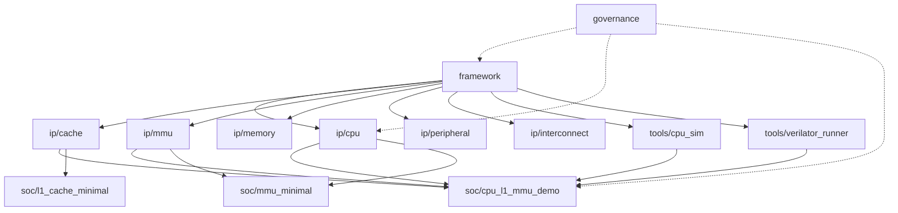

# Agent Scope Matrix —— build agent 的工作焦点协议

> ⚠️ **本文是规格文档**（设计说明 + 协议细节）。
> **每回合必须执行的硬约束摘要在 [`AGENTS.md` §7](../../AGENTS.md)** —— agent 不会主动来读本文，因此摘要必须自足。
>
> **生效范围：仅 build agent。** 其它 agent（explore / oracle / metis / critic / librarian / general）**完全忽略**全文。

---

## 1. 目的与定位

Scope Matrix 让 build agent 在每个回合开始时先知道「**我在哪**」，再决定建议焦点 / grep 范围 / 反向引用优先级。

它与 opencode 全局 Role Matrix **正交独立**：

| 维度 | opencode Role Matrix | 本 Project Scope Matrix |
|------|---------------------|------------------------|
| 目的 | agent 行为约束（who I am） | agent 工作焦点（what I am working on） |
| 状态位置 | `~/.config/opencode/AGENTS.md`（用户全局）+ `<cwd>/.rddf/state/role.json`（项目级） | `<cwd>/.rddf/state/scope.json`（项目级，git tracked） |
| 取值 | arch / planner / builder / verifier / no-role / general | framework / ip/`<name>` / soc/`<name>` / governance / tools/`<name>` |
| 副作用 | **enforcement**（允许/禁止动作：commit / edit / branch） | **advisory**（建议焦点 / grep 范围 / 反向引用优先级） |
| UI | `【角色: builder \| change: <名或无>】` | `【角色: builder \| scope: ip/cpu】` |

两个矩阵叠加完全有效：`role=builder` + `scope=ip/cpu` 无冲突。

---

## 2. 状态来源

- **状态文件**：`<cwd>/.rddf/state/scope.json`（项目级，与 `role.json` 同层）
- **fallback**：项目级缺失时视为 `governance/governance`
- **字段**：
  - `current_scope.category`：`framework` | `ip` | `soc` | `governance` | `tools`
  - `current_scope.target`：具体 ip / soc / 工具名（如 `cpu`、`cache`、`soc/cpu_l1_mmu_demo`、`cpu_sim`、`governance`）
  - `current_scope.sub_target`：可选，当前 work 落入的子目录（如 `plugins`、`docs`、`configs`、`core`）
  - `history`：scope 切换历史（`{from, to, at, by, trigger}`）
- **读取时机**：每个 build agent 回合开始时（含本回合响应前）
- **写入**：scope 切换时写项目级 `.rddf/state/scope.json`（与 `role.json` 模式相同：`updated_by` + 追加 `history`，history 只留最近 20 条）
- **gitignore 冲突**：`.gitignore` 有 `state/` rule，但 `scope.json` 是手维护 SSOT（与 `role.json` 同性质）⇒ 需 `git add -f .rddf/state/scope.json` 强制加入
- **初始化**：按 §7 schema v1 模板创建（幂等；已存在则覆盖为当前 scope）

---

## 3. 5 Categories × Targets 矩阵

| Category | Targets（示例） | 默认 grep 范围 | 主要反向引用 | 关联架构 gate 重点 |
|----------|------|----------|----------|------|
| `framework` | framework | `include/cf/plugin/` + `src/cf_plugin/` + `bundles/` | ADR-037/040/046/082/083（Plugin 框架） | check_portability + verify_decision |
| `ip` | cpu + cache + mmu + memory + peripheral + interconnect + tilecopy + tilecore | `ip/<target>/` + `tests/<target>/` | `docs/architecture/adr/` + `openspec/specs/<target>` | check_portability + verify_decision + verify_adr |
| `soc` | soc/cpu_l1_mmu_demo + soc/mmu_minimal + soc/l1_cache_minimal | `soc/<target>.json` + `tests/soc/<target>/` + `tools/{cpu_sim,verilator_runner}/` | `docs/architecture/` + SoC 级 DSE CSV | check_portability + verify_decision + verify_adr + E2E smoke |
| `governance` | governance | `.rddf/` + `openspec/` + `AGENTS.md` + `docs/` | rdd-workflow + sync 脚本 | doc_link_check + verify_adr |
| `tools` | cpu_sim + verilator_runner | `tools/<target>/` | tools 相关文档 | 工具级 smoke |

> **命名约定**：targets 镜像物理目录真实名字（`soc/cpu_l1_mmu_demo.json` 用**下划线**，不是 `soc/cpu-l1-mmu-demo`）。`/` 仅作 category namespace 分隔，文件系统路径用 `_`。

---

## 4. 切换触发 & 写入

- **显式 trigger**（默认）：user 说「切换到 ip/cpu」/「scout framework」/「回到 soc」/「scope=cache」
- **隐式 trigger（可选）**：build agent 可基于最近 git diff 路径**建议** scope（`git diff --name-only HEAD~N | grep -E "^ip/|^tests/|^soc/"`）⇒ **须 user 确认后**才写
- **写入**：触发时写 `.rddf/state/scope.json` 项目级（同 `role.json` 模式）
- **查看**：每回合开始读 `current_scope` 作 prompt context
- **不冲突**：scope 切换不影响 role

---

## 5. 开场报告格式

build agent 每回合输出（与 role 矩阵开场报告同位置，**最顶部**）：

```
【角色: <X> | scope: <Y>】
  <human-readable line>
```

示例：

- `【角色: builder | scope: ip/cpu】当前会话在 ip/cpu 工作，包括 plugins/docs/configs 子目录 + 关联 ADR-048/084/085 反向引用。`
- `【角色: builder | scope: governance】当前会话在治理层，grep 范围 = .rddf/ + openspec/ + AGENTS.md + docs/。`

> **格式差异**：全局 `~/.config/opencode/AGENTS.md` 的 builder 行使用 `change: <名或无>` tail；本项目使用 `scope: <Y>` tail。两者按 host file 区隔，各有独立语义，同时显示不冲突。

---

## 6. 默认行为

- **不自动切换**：scope 不跨 tool 自动切换（避免 cognitive drift）
- **不限制操作**：agent 在任一 scope 下都可读/写所有文件；scope 仅影响
  - 推荐优先级（scope=cpu 时 cpu 相关 grep 优先）
  - 反向引用范围提示（scope=cache 时 cache 相关 ADR/docs/specs 优先）
  - 架构 gate 重点（scope=ip/cache 时 check_portability + verify_decision 优先；scope=soc 时 E2E smoke 优先）
- **可手动 override**：user 任何时候说「scope 切换」即生效

---

## 7. scope.json Schema v1

```json
{
  "schema_version": "scope-v1",
  "current_scope": {
    "category": "<framework|ip|soc|governance|tools>",
    "target": "<target name, e.g. cpu, cache, soc/cpu_l1_mmu_demo, cpu_sim, governance>",
    "sub_target": "<optional, e.g. plugins, docs, configs>"
  },
  "updated_at": "<ISO8601 timestamp>",
  "updated_by": "user",
  "session_id": "<OpenCode session ID>",
  "history": [
    {
      "from": null,
      "to": "<category>/<target>",
      "at": "<ISO8601>",
      "by": "user",
      "trigger": "scope-matrix-proposal initial | user requested | agent inferred"
    }
  ]
}
```

---

## 8. 目录归属对齐

| 物理目录 | Scope category | 默认 target | rationale |
|---------|-------------|------------|------|
| `include/cf/plugin/` | framework | framework | `cf::plugin` namespace API |
| `src/cf_plugin/bridge/` | framework | framework | bridge 适配层（D4 ADR-041 例外） |
| `bundles/` | framework | framework | 共享 payload key（mem_bundles 等） |
| `ip/cpu/` | ip | cpu | IP 业务代码，ADR-083 v2.0 `plugins/` 双文件分离 |
| `ip/cache/` | ip | cache | IP 业务代码，`plugins/` |
| `ip/mmu/` | ip | mmu | IP 业务代码，lib + plugins 切分 |
| `ip/{memory,peripheral,interconnect,tilecopy,tilecore}/` | ip | (placeholder) | 0 代码，仅 README + STATUS 占位 |
| `soc/*.json` | soc | (per JSON) | SoC 拓扑声明 |
| `tests/soc/<soc-name>/` | soc | (per JSON) | SoC 测试 |
| `tools/{cpu_sim,verilator_runner}/` | tools | (per tool) | SoC E2E 工具链 |
| `.rddf/` + `openspec/` + `AGENTS.md` | governance | governance | workflow + 元文件 |

---

## 9. 关系图



> **实线** = scope 从属关系（scope=ip/cache 时 grep 自动覆盖 `ip/cache` + `tests/cache`）；**虚线** = governance 跨 scope 影响（governance 改动影响 framework + ip + soc 全栈）。

---

## 10. 口语口令（3 个）

> **前提**：opencode runtime **不解析真 slash command**（`/scope-show` 不会自动触发任何 tool）。这些是 user → LLM 的**口语口令**，靠 LLM 读到本节后理解执行。

### 10.1 `/scope-show`

**触发**：user 说 `scope?` / `scope status` / `/scope-show` / `我现在在哪?`

**动作**：读 `.rddf/state/scope.json` → 解析 `current_scope`（category + target + sub_target）+ `history` 倒序取最近 5 条 → 格式化输出。

```
【scope-show】
  current: governance/governance
  updated_at: 2026-10-19T00:23:59Z
  updated_by: user
  history (last 5):
    [2026-10-19T00:23:59Z] from=null to=governance/governance by=user trigger="scope-matrix-proposal initial"
```

### 10.2 `/scope-history`

**触发**：user 说 `scope history` / `scope 切换了什么` / `/scope-history`

**动作**：读 `.rddf/state/scope.json` 取 `history` → 倒序打印，每条带 `from/to/at/by/trigger` 五字段。

```
【scope-history】(2 entries, reverse-chronological)
  1. 2026-10-19T01:10:00Z | user | governance/governance → ip/cpu | trigger: "user 切到 ip/cpu 看 mul_div_fsm"
  2. 2026-10-19T00:23:59Z | user | (init) → governance/governance | trigger: "scope-matrix-proposal initial"
```

> history 为空（fresh clone）→ 输出 `【scope-history】history empty (fresh state, current_scope=governance/governance default)`。

### 10.3 `/scope-reset`

**触发**：user 说 `scope reset` / `回到 governance` / `/scope-reset`

**动作**：读旧值 → 写 `current_scope = {category: governance, target: governance, sub_target: null}` → 追加 history entry → 输出确认（写文件，不自动 commit；commit 由用户确认）。

```
【scope-reset】已重置回 governance/governance (原: ip/cpu)
  state file: .rddf/state/scope.json
  history: 1 new entry appended
```

> 5 categories 中 `governance/governance` 是 reset 默认值。

---

## 11. 速查表

| 用户说 | 触发动作 | 输出 |
|--------|----|----|
| `scope?` / `scope status` | `/scope-show` | §10.1 |
| `scope history` / `scope 切换了什么` | `/scope-history` | §10.2 |
| `scope reset` / `回到 governance` | `/scope-reset` | §10.3 |
| `切换到 <X>` / `scope=<X>` | 改 `current_scope` + 追加 history + 输出新开场报告 | §4 + §5 |
| `auto-pick` / `推荐 scope` | 基于 git diff 推断 + 提议（须 user 确认） | §4 隐式 trigger |

> **生效范围**：全部触发，不论当前 scope 状态。

---

## 附录 A. 设计背景

**改造前**：角色与 scope 靠 LLM 自觉读取 → 实际经常跳过开场报告，用户看不到 agent 的工作焦点。

**改造后**（§0.5 硬规范）：角色 / scope 双 read + 开场报告输出 + 切换 mark，**三件都变成硬规范**。

| 维度 | Before | After |
|------|--------|-------|
| 角色 read | 靠 LLM 自觉 | 硬规范，每回合必读 |
| Scope read | 靠 LLM 自觉 | 硬规范，每回合必读 |
| 开场报告输出 | 靠 LLM 自觉 | 硬规范，每回合必出（响应最顶部） |
| 切换 mark 显式 | 不强制 | 硬规范，scope 变化必须显式写 |
| 用户认知成本 | 中（LLM 可能忘） | 低（每次响应都看得到） |
| 实施成本 | 0 | 0 |
| 跨 session 行为 | session-bootstrap 默认 `general` + `governance` | 同，但有硬规范 ensure |
| runtime patch | 无（opencode runtime 不能 patch LLM 行为） | 无（仍靠 LLM 读 §0.5） |

**与全局 Role Matrix 角色切换的差异**：

| 触发 | opencode Role Matrix | 本 Scope Matrix |
|------|---------------------|---------------|
| 触发频率 | 仅当 user 说「切换到 X」（低频） | 每回合（高频） |
| 触发方 | user（显式） | LLM（每回合自动） |
| 副作用 | 写 `role.json` + 输出新角色开场报告 | 读 `role.json` + `scope.json` + 输出角色 + scope 开场报告 |
| 角色 vs scope | 仅角色 | 角色 + scope（双 read） |

## 附录 B. 遗留 follow-up

- 目录归属表中 `ip/{memory,peripheral,interconnect,tilecopy,tilecore}/` 仍是 placeholder（0 代码，仅 README + STATUS 占位）—— 待 IP 实体化后回填。
- `tests/bundles/` 与 `tests/cpu/configs` → `tests/cpu/schema` 的目录归属已在代码层完成，本表无需再改。
